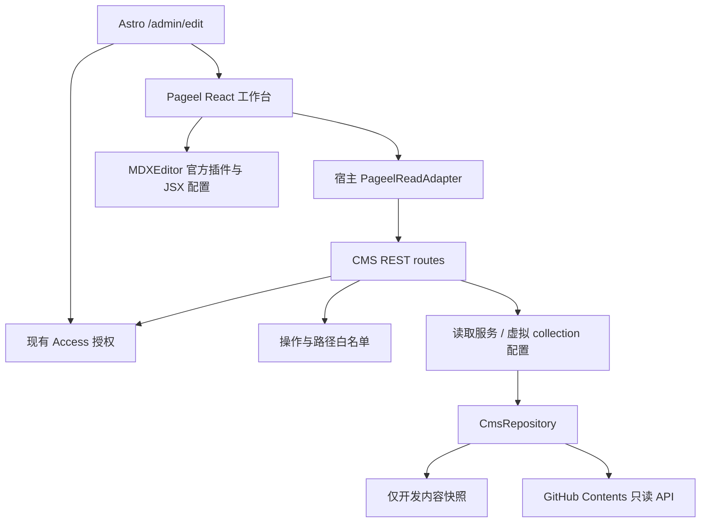
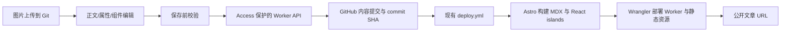

# Pageel 文章后台接入 Spec

- 日期：2026-10-22
- 状态：Pageel 已集成本地编辑台，UI 已完成；写入、上传、发布尚未开放。下一阶段以第 14 节为准。
- 决策：退役本站自建文章工作台；复用 Pageel 完整 React 工作台，集成现有 Astro / Cloudflare Worker。通过固定版本的上游源码包与小型适配补丁维护，不拆散复制后重建同类后台。
- 需求来源：[Blog CMS PRD](../blog-cms-prd.md)。本文替代旧 PRD 中的自建工作台、文章 REST API 和 Worker 写入实现方案。

## 1. 目标与范围

提供文章列表、属性表单、正文可视化编辑、源码恢复、媒体管理和 Git 保存。博客保留 MD/MDX，Stories 仅允许纯文字 MD。公开网站继续使用现有 Astro 5、React islands、内容集合和 Cloudflare Worker。

硬约束：管理员仅通过 Cloudflare Access 登录；GitHub 凭证仅在 CMS 服务端；不出现 GitHub OAuth、粘贴 token 或额外 CMS 密码流程。原有文章路径、URL、语言、未知字段和组件语义必须保留。

允许的适配仅限：认证桥接、集合与组件配置、必要的保存校验和小型上游修复。不自建富文本内核、差异算法、媒体库、文章工作台或 MDX 转换器。若缺口需要这些开发，判定选型不通过。

## 2. 源码核查基线

上游：[pageel/pageel-cms](https://github.com/pageel/pageel-cms)。核查 commit：`545483babb0258b9493dcc844856ff9326bd592d`。后续原型固定该 SHA，并保存依赖锁文件；升级必须重新跑兼容性样本。

以下是源码阅读结果，不是运行验收：

| 核查位置 | 结论 | 设计影响 |
| --- | --- | --- |
| `package.json`、`astro.config.mjs` | Astro 6 / React 19，SSR，默认 Vercel adapter；注释给出 Node 部署方向 | 不引入上游 Astro 宿主；提取上游完整客户端构建入口，保留本站 Astro 5 宿主；Worker 兼容性必须实测 |
| `packages/cms-bridge/src/index.ts` | 扫描目录、生成 `.pageelrc.json`、注入跳转路由；不负责托管完整后台，也不解析 Zod 全部字段 | 不将安装 `@pageel/cms` 当作完整接入；显式配置集合 |
| `packages/plugin-mdx/package.json` | 插件 0.2.6，依赖 MDXEditor `^3.20.0` | 不套用本站此前 4.x 的兼容性结论 |
| `packages/plugin-mdx/src/MdxSlot.tsx` | 已接入基础格式、图片和代码块；没有配置 JSX、表格、公式插件；onChange 有 300ms 防抖 | “MDX 插件”不等于支持本站复杂 MDX；快速保存和切换须验证 |
| `packages/plugin-types/src/index.ts` | 提供 editor/toolbar/preview slots 和受限图片服务接口 | 可采用官方插件扩展点；不复制整个编辑器 |
| `src/middleware.ts` | 校验 CMS session、Git 凭证和 mutation CSRF | Access 不能仅放在外层后删掉现有保护 |
| `src/lib/auth-bridge.ts` | 对接 Pageel SaaS bridge，不是 Cloudflare Access provider | 需独立 Access 适配；不启用 SaaS 登录 |
| `src/services/proxyGitService.ts`、`src/hooks/usePostActions.ts` | 页面通过代理请求保存，更新携带 SHA | 复用服务端 Git 流程；实际冲突行为待测 |
| `packages/cms-bridge/src/index.ts` | 文件写入用于配置生成 | 不能据此宣称支持本地文章写盘 |
| `src/hooks/useSessionRestore.ts` | 有清理 localStorage 的逻辑 | 不能把编辑防抖等同于持久化草稿；须验证登录恢复与草稿关系 |

项目声明 MIT；分发时保留上游 LICENSE 与 notices。上游 README 的功能描述仅作线索，以上 SHA 的实现与原型结果优先。

## 3. 现有 Cloudflare 架构与接入设计

**同一项目、同一 Cloudflare Worker、同源后台和 API。无需独立 Node 服务、VPS、容器或第二个 CMS 域名。**本节取代前版独立 Node 设计。

### 3.1 已有基础设施（本地代码核实）

| 已有实现 | 复用方式 |
| --- | --- |
| `astro.config.mjs`：Astro 5、`output: server`、Cloudflare adapter、React / MDX 集成 | 保留现有宿主，不整站升级到上游 Astro 6 |
| `wrangler.toml`：`dist/_worker.js`、ASSETS、`nodejs_compat`、compatibility date 2026-03-31 | 同一构建、同一 Worker 部署；不认为 nodejs_compat 等同完整 Node 环境 |
| D1 `DB`、业务缓存 `KV`、Astro `SESSION` | 首版不新增文章数据库或 CMS session 存储；文章继续以 Git 文件为事实来源 |
| `src/server/env.ts` 的 `getServerEnv` | 从请求 runtime bindings 读取 CMS secret，避免构建期内联 |
| `src/server/security/access/` | 复用 Access JWT、管理员身份、capabilities 与本地开发策略 |
| `src/server/rest/` | 复用请求上下文、request ID、错误响应与 no-store |
| `src/server/admin/session/routes.ts` | 使用现有管理员会话响应初始化 CMS 身份 |
| `.github/workflows/deploy.yml` | 沿用 GitHub Actions 构建和 Worker 发布 |

```mermaid
flowchart TD
    Browser[管理员浏览器] --> Access[现有 Cloudflare Access]
    Access --> Site[现有 Astro / Cloudflare Worker]
    Site --> UI[/admin/edit: Pageel React 工作台]
    UI --> API[/api/v1/admin/cms/*]
    API --> Auth[现有 authorizeAdmin / authorizeAdminMutation]
    Auth --> GitClient[Pageel Git 客户端 + Worker 适配]
    GitClient --> GitHub[固定 GitHub 仓库]
    GitHub --> Actions[现有 deploy.yml]
    Actions --> Site
```

### 3.2 上游复用方式

上游 `src/pages/cms.astro` 使用 `CmsClient client:only="react"`，`App.tsx` 是 React 工作台；不需要把上游 Astro 6 服务整体搬进来。`@pageel/cms` 是跳转/配置桥接，不能作为可嵌入完整后台的 npm 包使用。

原型阶段将固定 SHA 的源码置于独立 vendor/package 边界，保留上游目录结构、LICENSE、版本清单与补丁记录；基于上游客户端入口构建一个可由本站导入的浏览器模块。它是现有工作台的打包适配，不新增文章列表或编辑器实现。正式维护方式优先固定 fork commit / 内部制品；不得追踪浮动 main。

建议新增边界（均为计划，当前未创建）：

- `packages/pageel-workbench/`：完整上游 React UI、插件及构建配置；与本站共享兼容的 React 单实例，不引入上游 Vercel/Node adapter。
- `src/pages/admin/edit.astro`：动态页面，请求时检查 admin:read；加载客户端工作台，禁止 prerender。
- `src/lib/admin/pageel-adapter.ts`：统一 API 前缀、会话映射、错误响应映射；不重建编辑状态管理。
- `src/server/admin/cms/`：Pageel Git 操作适配与本站权限/内容约束。
- `src/pages/api/v1/admin/cms/`：薄路由，复用现有 REST 框架。

Pageel 会操作 body class 并自带全屏布局/CSS；编辑页采用独立文档布局，保持“返回管理后台”入口，不嵌套在 AdminShell 的双侧栏中。CSS 仅在编辑路由加载；不得影响公开文章及友链后台。动态编辑路由中的客户端脚本不包含 Git 凭证。

### 3.3 路由与服务契约

| 对外入口 | 来源/职责 | 权限 |
| --- | --- | --- |
| `/admin/edit` | Pageel 完整工作台 | admin:read |
| 现有 admin session API | 初始化 actor/capabilities | 现有鉴权 |
| `/api/v1/admin/cms/git` | 适配上游 `/api/proxy/git` 操作 | 读操作 admin:read，写操作 admin:write |
| `/api/v1/admin/cms/upload` | 上游上传流程与固定媒体目录校验 | admin:write |
| `/api/v1/admin/cms/blob/...` | 部署前受保护媒体读取 | admin:read |
| `/api/v1/admin/cms/config` | 返回版本化集合配置，首版只读 | admin:read |

上游 ProxyGitService 中 `/api/proxy/*` 是硬编码后缀，仅设置 baseUrl 不足以得到目标路径；必须通过一个小型上游补丁或 transport adapter 统一改写所有 git/upload/blob/settings/session URL。不能只改一个请求留下未受保护旧端点。

HTTP POST 的 git dispatcher 可能同时承载查询与写入，必须先对 operation 做白名单分类；读取需要身份授权，写入还需要 authorizeAdminMutation。未知 operation、删除、移动、改配置、切换仓库/服务商/分支默认拒绝。路径与内容约束在服务器执行，不以隐藏 UI 代替。

沿用本站 JSON envelope；客户端适配层负责转成 Pageel 期望结构，并保留 401/403/409 的语义，媒体端点返回二进制。冲突使用真实基准 SHA，禁止自动读最新 SHA 后覆盖重试。

### 3.4 Worker 运行时适配

- 上游 `src/lib/git-client.ts` 核心使用 fetch；复用其 API 操作，显式传入固定 GitClientConfig，替换 `import.meta.env` 凭证回退。
- 在 `CloudflareEnv` 与 `getServerEnv` 增加专用 Git token/repo/branch 配置。token 为 Worker Secret；仓库/分支由服务端固定。客户端不能提交 token、远端主机或任意 fetch URL。
- 上游 upload 使用 File、arrayBuffer、Uint8Array，可先沿用并使用现有 bounded body 工具限制读取；在 workerd 验证 multipart、二进制编码和媒体响应。
- 配置扫描、插件打包只发生在开发/CI。生产不执行 node:fs 写仓库、不启动 shell/git、不动态 npm install，也不从任意 URL 加载插件。
- Workers 的 node:fs 是虚拟文件系统，临时写入不是持久化 Git checkout；线上文章与图片写入 GitHub，不能依靠 `/tmp` 保存。
- 首版不引入 D1 草稿表、KV 文件存储、R2 或新的 SESSION 用法。已有资源不等于必须用于 CMS；若后续明确需跨设备草稿，再单独设计。
- 在现有 compatibility date 下做 wrangler dry-run 和 workerd 冒烟测试；只有出现确切 API 缺口才考虑升级日期/flag，并回归现有服务。

## 4. 复用现有 Access 认证

不引入 Pageel 密码登录、CMS_SECRET session、SaaS bridge 或 GitHub OAuth。适配其客户端初始化为现有 AdminSession，将 actor、capabilities、固定仓库描述映射给 Pageel store；Git token 不进入 store。

1. 页面和每个 API 独立调用现有鉴权函数；不能只依赖页面入口。
2. 读取使用 `authorizeAdmin(..., 'admin:read')`；所有写操作使用 `authorizeAdminMutation(..., 'admin:write')`，继续校验浏览器 Origin。
3. Pageel session/CSRF 依赖在 transport/auth 适配边界统一替换为本站现有 Access + 同源策略；这是替换整套安全机制，不能只删除 CSRF header 检查却保留不受保护的写接口。
4. 沿用本地 `local-development` 认证与站点 origin 限制，生产不能启用开发豁免。
5. `/admin/edit` 与 `/api/v1/admin/cms/*` 位于已有 Access 路径命名空间。上线仍要复核云端策略实际生效，不能把本地设计文档当作当前控制台事实。
6. 上游 logout/session restore 中的 `localStorage.clear()` 必须替换为仅处理 CMS 自有命名空间；同源部署不能清除本站其他应用状态。退出沿用项目现有 Access 退出方式，不能调用未部署的 `/api/auth/logout`。

验收：过期/伪造 JWT、错误 audience、非管理员、只读用户写入、跨 Origin 与缺失 Origin 的浏览器写入均拒绝；无第二次登录；未知端点不存在；Git token 不进入网络响应和客户端产物。

## 5. 内容配置

| 集合 | 文件与命名 | 字段 | 限制 |
| --- | --- | --- | --- |
| Blog | 保留 `content/blog/**/*.md` / `*.mdx`；新中文文件使用 `-zh` 后缀 | title、description、pubDate、updatedDate、tags、draft、lang、heroImage、shareText、llms | 语言来自 frontmatter；旧文件不重命名 |
| Stories | `content/stories/**/*.md`，不自动添加语言后缀 | title、description、pubDate、updatedDate、tags、draft、lang、已有 llms | 禁用标题、代码、图片、公式和组件插入；保留 `<br/>` 与场景分隔 |

- 字段默认值与 `src/content.config.ts` 一致，特别是 `llms`；现有中文标签不得被英文 slug 规则拦截。
- 集合模板使用 Pageel 已有配置格式；实施时核对类型后再提交 `.pageelrc.json`，本 spec 不虚构可运行配置。
- 当前 Astro stories loader 也匹配 MDX，但本 CMS 仍遵守仓库纯 MD 内容规则；不修改公开集合 schema。
- Blog 中文 URL 去除 ID 末尾 `-zh`；Stories 不去除。创建前校验不同扩展名和语言后缀归一化后的 URL 冲突。
- 更新不丢未知字段、不截断日期时间；不编辑正文时正文应保持不变。YAML 注释/序列化变化须记录并人工评估，不能宣称字节无损。

## 6. 编辑与预览

直接使用 Pageel 工作台与官方 MDX 插件。缺少的表格、源码/diff、JSX 仅通过 MDXEditor 官方插件及通用属性编辑器配置；优先向上游提交配置扩展支持。若必须维护另一套 editor slot，先判定是否违反“不自建”的范围，不能默默重做现有实现。

组件样本至少包含 ExploreCard、PreviewLink、BlockQuote、Cite、References，以及 `client:load` / `client:visible`、命名 imports、嵌套 JSX、数组/对象属性。普通 Markdown 与常用 ExploreCard 应可视化编辑；复杂内容可明确进入上游源码模式，但不得静默丢节点，也不得所有 MDX 都退回源码。

预览分为两类：Pageel 内置预览只声明其已验证的 Markdown 能力；完整交互组件与 hydration 以实际 Astro 构建预览为准。不另写 MDX 到 HTML 转换器。未保存的完整页面预览若上游不具备，记录为缺口，不宣称已有。

公式是单独门槛：验证 `$` / `$$` 在可视化修改其他段落后仍能保留并正确构建。不因 KaTeX 预览可见就判定编辑支持通过。

## 7. 图片、草稿与发布

### 图片

复用 Pageel 媒体库与插件上传接口。存储在 `public/images/blog/` 允许目录，正文保存 `/images/blog/...`；验证部署前后台读取和粘贴/拖放。Stories 禁止上传。第三方图片来源仍须按仓库规则登记 `src/data/imageCredits.ts`；首版通过现有代码流程登记，不能用 CMS 上传自动替代。

图片与正文是否分成多次提交由原型确认。失败时保留编辑内容并提示已上传但未引用的资产，不自动删除用户文件。

### 草稿

区分浏览器临时编辑、仓库 `draft:true`、公开文章三个状态。禁止将已发布文章“暂存”实现为改成 `draft:true`。Pageel 持久化恢复、跨页面切换和冲突 diff 尚未验收；若无现成功能，必须记录阻塞，不能重新实现整套草稿系统。

### 发布

首版沿用 PRD 的直接提交 main 语义：CMS 保存成功表示 Git 提交成功，实际上线由现有 `.github/workflows/deploy.yml` 完成。构建失败时 Git 已修改、线上仍可能是旧版本；通过现有 Git 工作流修复或 revert。

优先使用 GitHub Actions 页面查看部署结果，不重建自定义轮询徽章。将来显示“已上线”时必须依据该 commit 的指定工作流成功；Pageel 保存提示不能冒充部署成功。PR 预览发布作为独立后续决策，本轮不更改 CI。

## 8. PRD 差距与决策门槛

| 要求 | 当前判断 | 处理 |
| --- | --- | --- |
| 完整文章/媒体工作台 | 上游已有 | 直接复用 |
| Access 唯一登录 | 现有服务端能力可复用，需适配 Pageel 初始化 | 使用本站 AdminSession 和 authorizeAdminMutation 后验收 |
| 现有 JSX、表格、公式 | 默认插件不足 | 官方插件配置原型；不允许静默降级 |
| 本地服务端直接写文章文件 | 本轮未找到现成支持 | 保留为未满足硬约束；不能将本地连接 GitHub 当成本地写盘 |
| 同一 Worker 内运行 CMS | 目标部署约束，待原型验证 | 客户端复用 Pageel，服务端适配现有 REST/Access；不改为独立 Node |
| 浏览器暂存与冲突恢复 | 未验证 | 作为采用门槛 |
| 完整未保存 Astro 预览 | 未验证 | 明确缺口；不自建转换器 |

若本地写盘或复杂 MDX 需要大规模新增实现，Pageel 不通过选型。此时输出明确取舍供用户决定（如放宽本地模式或改选成熟方案）；不得擅自放宽需求，也不得恢复自建后台。源码核查完成不等于批准生产迁移。

## 9. 实施阶段与验收

1. **清理（本轮）**：移除自建编辑器、文章 API、专用测试/契约、导航接入及专用依赖；保留原内容、公开页面、原后台和本文档。
2. **隔离原型**：固定上游 SHA，在本站 Astro 5 宿主构建 Pageel 完整客户端，API 挂现有 Worker；使用测试仓库和独立测试环境，无生产凭证。执行 wrangler dry-run、workerd 请求测试和客户端包扫描。
3. **编辑兼容性**：复制全部现有文章，执行打开→切换视图→修改普通段落→立即保存→重开；比较 metadata/body diff 并运行本站构建。无操作打开不得产生提交。
4. **接入验证**：Access/session/CSRF、固定仓库和路径限制、图片预览、双窗口 SHA 冲突、网络失败、300ms 内保存和切换、中文输入法、手机布局、草稿恢复。
5. **决策评审**：逐项列出通过/未通过/所需补丁；本地写盘和公式等缺口不得用“基本可用”关闭。
6. **正式接入**：验证通过并确认部署资源后，添加 `/admin/edit` 导航入口和 Worker Secrets，复核现有 Access 路径；经授权执行一篇测试内容发布，核对 Git SHA、Actions 和公开 URL。

验收样本：`astro-to-nuxt-ecosystem-fullstack.md`（表格/代码）、`ai-draft-generation-queue-sse-guide.mdx`（ExploreCard/长文）、`miles.mdx` / `miles-zh.mdx`（复杂 JSX）、`fragment.md` / `fragments.md`（中文标签/换行/强调）；补充多行 YAML、未知字段、公式、非法 MDX 和不支持组件。

设计阶段未创建 CMS 路由；随后实施状态以第 12 节为准。

上线失败回退：撤下 CMS 入口、移除 Worker 中 CMS 写入凭证，继续原 Git/本地代码编辑流程；必要时通过普通 Git revert 回退具体内容提交。无需恢复已退役自建工作台。

## 10. 参考与证据

- [固定版本上游源码](https://github.com/pageel/pageel-cms/tree/545483babb0258b9493dcc844856ff9326bd592d)
- [MDX 插件实现](https://github.com/pageel/pageel-cms/blob/545483babb0258b9493dcc844856ff9326bd592d/packages/plugin-mdx/src/MdxSlot.tsx)
- [Astro 集成桥接实现](https://github.com/pageel/pageel-cms/blob/545483babb0258b9493dcc844856ff9326bd592d/packages/cms-bridge/src/index.ts)
- [上游认证中间件](https://github.com/pageel/pageel-cms/blob/545483babb0258b9493dcc844856ff9326bd592d/src/middleware.ts)
- [MDXEditor JSX](https://mdxeditor.dev/editor/docs/jsx)、[源码与 diff](https://mdxeditor.dev/editor/docs/diff-source)

## 11. 本地模式与实施顺序补充

### 本地与线上持久化边界

“CF 全栈部署”是生产运行约束；开发/CI 使用 Node 构建工具不等于单独部署 Node 服务。现有 PRD 的本地直接写仓库文件仍需独立验证：

- 生产和 workerd 集成测试：统一 GitHub adapter，测试指向隔离仓库；本地测试不能写生产 main。
- 本地直写需求：仅在 `pnpm dev` 宿主允许真实磁盘访问时，评估复用成熟本地 Git/文件 adapter 或上游实现；不得将 workerd 虚拟 fs 当作宿主 checkout。
- 本轮没有找到 Pageel 现成本地文章 adapter。该项继续标记未满足，不自动改为云端写入；若必须重新开发一套存储系统，停止并提交取舍，不恢复旧自建 API。

### 原型顺序与停止条件

1. 先验证 Pageel 完整客户端可在本站 Astro 5/React 19 构建、按路由隔离样式，无上游服务器依赖泄漏。
2. 验证现有 session 初始化和单个受保护 Git 读取，再接保存/上传；不整体复制上游 middleware 和 API。
3. 验证 workerd 中 fetch、编码、上传以及请求时 secret 注入，生产 bundle 无 fs 写入和 Node server adapter。
4. 再执行第 9 节全部内容与发布验收。JSX、表格、公式以及本地写盘的缺口仍然有效，CF 适配成功不代表 CMS 选型完成。
5. 若适配扩大到重写 Dashboard、编辑器内核、草稿系统或内容序列化器，判为 Pageel 不适合本约束，输出证据；不得以独立 Node 部署绕过用户要求。

新增验证：构建前后公开页面/友链 API 不受影响；编辑器 chunk 不进入公开路由；同源 logout 不清空其他功能存储；所有 CMS 请求落入 `/api/v1/admin/cms/*`；read/write capability 和 Origin 策略在 workerd 中有效；管理员 API 与媒体 `Cache-Control: no-store`。

Cloudflare 官方运行时依据：[Node 兼容性](https://developers.cloudflare.com/workers/runtime-apis/nodejs/)、[虚拟文件系统](https://developers.cloudflare.com/workers/runtime-apis/nodejs/fs/)。原型通过前，本 spec 不宣称 Pageel 官方已支持本站 Cloudflare 部署。

## 12. 首轮实施记录（2026-10-22）

已开始按模块实现；当前为**禁止持久化的兼容性原型**，不是可上线 CMS。

- 上游边界：`packages/pageel-workbench/`，保留固定 SHA、MIT LICENSE 和补丁台账。
- 页面：`/admin/edit`，现有 Worker 动态路由，现有 Access 授权，独立文档/CSS。
- 客户端：`src/lib/admin/pageel-adapter.ts`，复用 adminApiRequest。
- 服务端：`src/server/admin/cms/{config,policy,repository,service,routes}.ts`。
- 读取 API：`/api/v1/admin/cms/git`、`/api/v1/admin/cms/session`，只读操作白名单。
- 本地：开发模式提供服务器端内容快照；不是文件写入。生产构建排除快照，缺少 GitHub 配置时拒绝读取。
- 保存、上传、删除、改配置在客户端和服务端均拒绝；尚未实现写入开关。可在内存中试编辑，页面明确提示离开即丢弃。
- 固定 MDXEditor 3.20.0；默认上游插件确实不能完整导入本站长文，已追加官方表格/代码/JSX 插件和原文错误恢复；完整无损往返仍待验收。
- 此次只读 GitHub transport 为小型宿主适配，尚未接入上游写操作，不宣称完整发布链路完成。

模块维护与升级方式见 [工作台 README](../../packages/pageel-workbench/README.md)。原型若证明需要重写编辑器或序列化器，依第 11 节停止扩展，不以开放写入绕过验收。


### 12.1 实际验证与停止条件

2026-10-22，在本地 `/admin/edit` 使用真实文章的只读快照验证：

| 验证项 | 结果 | 后续处理 |
| --- | --- | --- |
| Astro 5 / React 19 加载完整上游列表与编辑视图 | 通过 | 保留 client-only 边界 |
| 长文表格、代码块、ExploreCard 导入 | 官方插件配置后可打开 | 全量语义 diff 与保存重开尚未验收 |
| `miles-zh.mdx` 嵌套 JSX、hydration 属性、profile 对象 | 切换 Source 后保留 | descriptor 必须配置 source/defaultExport 与真实 props |
| 仅打开文章不产生修改状态 | 未通过 | MDXEditor 归一化触发 dirty；禁止据此创建提交 |
| 只改标题保留其他原文 | 未通过 | 上游 updateFrontmatter 丢 YAML 注释、改变日期格式并 trim 正文 |
| 公式样本 `$x^2$`、`\frac{1}{2}` | 样本文本往返保留，但没有数学编辑/渲染 | 不视为公式支持通过 |
| Worker 打包 dry-run | 通过 | 未部署，不能替代 workerd 请求验收 |
| 写入与越界路径保护 | 新增 5 项单测通过 | 所有变更操作在两端拒绝 |

frontmatter 最小复现：含 `title: "Sample" # retain comment`、日期 `2026-10-22` 和正文前后空行的文件，经上游 `updateFrontmatter(content, {title: 'Changed'})` 后，注释丢失、日期变为 `2026-10-22T00:00:00.000Z`、正文空白被 trim；未知字段仍保留。不能把未知字段保留等同于无损保存。

根据第 11 节停止条件，当前暂停扩展保存、媒体上传和发布模块。继续开发前需要采用可保留源文的成熟序列化能力，或明确调整原文保真验收标准；不能为了完成发布接口而默认接受内容重写。源文模式也不能绕过 frontmatter 序列化问题。

### 12.2 已落地模块依赖



后续模块按依赖顺序实施：编辑保真门槛 → 写操作与 SHA 冲突 → 媒体上传/引用 → 发布状态与恢复。当前没有为这些未通过前置验收的功能放置伪实现或开放写入入口。生产运行继续只有现有 Cloudflare Worker，无新增 Node 服务。


### 12.3 工作台入口与界面优化

按用户后续明确要求，后台统一导航已增加“文章工作台 / 验证中”，以完整页面导航进入独立工作台；此入口不代表正式发布验收通过。

界面继续复用 Pageel。宿主样式和中文映射集中在 `packages/pageel-workbench/integration/`：正文限宽、属性折叠、继承后台主题、中文字段和工具栏。集合切换会卸载旧文章视图；同源 public 图片不再走上游不存在的代理；禁止持久化的按钮明确禁用，状态显示“仅内存编辑”。发布与保真阻塞保持不变。


### 12.4 后台嵌入与模块边界（2026-10-23）

`/admin/edit` 现已使用 AdminLayout 和 AdminApp；后台导航改为 SPA 模块切换。
ArticlesAdmin 懒加载 package 公共入口，复用宿主会话并注入同源适配器。
Pageel Dashboard 的 embedded 模式仅保留内容管理区域，宿主管理导航、账户和主题。
自定义组件、样式、中文映射与 JSX 描述均位于 integration，不新增 upstream/custom。
上游保留必要的小型扩展参数和状态回调补丁；关键生命周期、样式和鉴权边界添加中文注释。

写入、媒体上传、发布继续关闭。离开保护不替代草稿恢复和保存保真验收。


### 12.5 项目组件编辑模块

组件接入由项目配置控制，详细边界见下方“项目组件配置与编辑台适配”。
已建立注册表、局部属性更新、选择上下文、原生编辑适配与右栏表单；
Highlighter / PreviewLink 支持字面量参数编辑及当前编辑器内撤销。
真实交互预览和复杂表达式表单仍待验证，保存保真门槛保持不变。


## 13. 项目组件配置与编辑台适配

更新：2026-10-23。适用于当前只读持久化验证阶段。

### 13.1 产品边界

正文文字直接编辑；组件参数在右侧“当前组件”配置；“文章属性”仍管理 frontmatter。
真实项目组件不挂载到 contenteditable 内，不执行动画、导航、远程 hover 请求。
编辑态样式只是近似表达，当前 marked 预览不是 Astro MDX 真实预览。

当前文章使用的 5 个组件已全部配置接入。Highlighter 的 action/color、PreviewLink 的 href、ExploreCard 的 title、TechSkillsCloud 的 headingId、TechStackTerminal 的 successMessage 支持属性表单；profile 对象表达式继续源码编辑。
插入组件菜单、选区包裹、高级组件表单、真实交互预览均尚未实现，不能据此开放发布。

### 13.2 目录与职责

```text
src/config/content-components.ts      项目已有组件的单一接入配置
packages/pageel-workbench/integration/
  component-config.ts                宿主配置适配边界
  jsx-descriptors.ts                 配置 → MDXEditor descriptor
  jsx-attributes.ts                  AST 字面量局部更新及配置驱动校验
  components/
    InspectorContext.tsx             选中状态与 portal 挂载点
    RegisteredJsxEditor.tsx           官方节点适配
    ComponentProperties.tsx          配置生成属性表单
```

不建立单独的 component-editing 目录，也不复制现有业务组件。组件源码保持原位置。
配置声明 name、source、defaultExport、kind、hasChildren、enabled 和 fields。
fields 声明名称、中文标签、控件类型、选项、必填和占位提示，表单与校验共同消费。
enabled 控制属性编辑接入；关闭时仍保留识别描述符，避免旧文章失去节点识别。
目前没有组件插入菜单，因此此开关不声称控制尚未实现的插入行为。
后续组件库列表应只展示 enabled 项；当前文档列表应显示所有实际使用项（含停用状态）。
纯 Markdown stories 不开放项目组件；现有服务端集合规则保持不变。

- attributes 不解析/序列化 MDX，只在官方传入的 AST 上替换明确属性。
- InspectorContext 不存正文、属性副本或持久化草稿；每个文章详情实例独立。
- RegisteredJsxEditor 复用 GenericJsxEditor 的子内容编辑能力及 useMdastNodeUpdater。
  关闭通用 PropertyPopover，避免其重建全部 attributes。
- ComponentProperties 经 portal 显示在右栏，仍属于原节点 React 生命周期；
  表单应用直接更新当前官方节点，不注册全局回调，不维护第二套编辑历史。
- 上游 PostList 只增加 Provider；PostDetailView 只增加面板挂载点和显示模式。

### 13.3 交互规则

1. 点击组件内文字或键盘聚焦，选中最近一层组件，右栏切到“当前组件”。
2. 嵌套节点停止向外传播选择事件，PreviewLink 与外层 Highlighter 可分别选择。
3. 配置按钮在悬停/聚焦时显示，提供明确名称；不拦截普通文字输入。
4. 表单修改后点击“应用参数”，修改进入 Lexical 撤销历史；不是保存到仓库。
5. 切回文章属性不清空节点；切换源码/文章、节点卸载时清空已选节点，避免悬挂引用。
6. 未点击应用的表单输入属于临时输入，切换组件会丢弃；不是自动保存。
7. 正文与右栏桌面独立滚动，窄屏仍按现有单列布局处理。

### 13.4 保真规则

- 只更新注册且开放的属性，未知属性、client:* 布尔属性、其他表达式原样保留。
- 不修改 children、导入声明或节点类型；文字更新交给官方嵌套编辑器。
- 属性是表达式、有重复名称、或节点带 spread 时，普通表单禁止修改；提示使用源码。
- action 校验枚举，color 首阶段支持十六进制；href 支持 http(s)、站内路径与锚点。
- 已有但不在表单允许值范围内的字面量不自动转换；未改动的属性不回写。
- 清空可选参数表示删除以恢复默认值；必填 title/href 拒绝清空。
- 这些规则只覆盖组件属性更新，不解决上游 frontmatter 重写和整个文档归一化问题。

### 13.5 后续扩展与预览

按顺序扩展：

1. 配置扩展：新增字段按实际组件 props 声明；数字、布尔和对象表达式暂不做自动转换。
2. TechStackTerminal：profile 对象需要独立验证结构化表达式能力；不可用 eval 或正则修改。
3. 插入菜单：使用 MDXEditor 官方 insertJsx$；默认 import/hydration 来自注册表。
   选区包裹需验证官方 selection API，不通过字符串切片处理嵌套 MDX。
4. 真实预览：独立 iframe 与预览构建链路，明确草稿输入、资源解析、错误返回和生命周期。
   需单独验证 Cloudflare 运行约束与未保存 MDX 编译方案；本轮不创建假预览接口。

### 13.6 验证结果

- 三项定向测试：局部更新保留未知/布尔/表达式属性；拒绝不确定属性覆盖；白名单值校验。
- miles-zh 浏览器验证：修改 color 后 client:load、action、四个 import、profile 对象仍在。
- 原生撤销/重做同步回右侧颜色表单；嵌套 PreviewLink 可独立选中。
- 本次验证颜色已恢复。未提交文章内容，未启用保存与发布。
- 撤销仅在当前编辑器生命周期内验证；跨源码切换的历史、手机交互、全量组件兼容性待验收。

## 14. 下一阶段：编辑到站点 URL 的功能闭环

更新：2026-10-23。UI 已完成，本节为下一阶段实施设计，不表示写入能力已开放。实现与旧章节描述冲突时，以当前代码和本节明确的状态为准。

### 14.1 当前代码基线

| 环节 | 已有实现 | 尚缺能力 |
| --- | --- | --- |
| 正文 | Pageel + MDXEditor，源码模式、撤销、5 个项目组件配置 | 全量 MD/MDX 往返保真验收、Stories 专用能力限制 |
| 组件 | 配置、表单、官方插入桥接与实例列表 UI | 插入可靠性、默认属性/hydration、实例解析验收；真实 Astro 预览（见 15.1） |
| 仓库读取 | `/api/v1/admin/cms/repository`、服务端 GitHub Contents API；开发快照 | 当前 `PageelReadAdapter` 所有写方法拒绝；repository 只有 read/list/sha |
| 保存 | 页面可持有未保存修改 | 创建/更新接口、基准版本、冲突处理、恢复验收 |
| 图片 | Pageel 上传入口；项目通用 `validateImage` | CMS 上传、GitHub 二进制写入、部署前受保护读取 |
| 发布 | deploy.yml 在 main/master push 时 build + wrangler deploy | CMS 提交与指定部署结果的关联 |
| 站点 URL | Astro 内容集合、预渲染详情页 | 后台统一 URL 计算；当前 findProductionUrl 返回 null |

现有 media/image-service 使用对象存储协议；CMS 首版仍按第 7 节写入 Git 图片目录，仅复用图片校验与有界读取，不混用对象 key 和站点 URL，不新增 R2 或文章数据库。

### 14.2 明确保存、修改和发布的含义

继续既定“直接提交部署分支”方案，避免暗中引入另一套草稿系统：

- 新建文章默认 `draft:true`；“保存草稿”表示文件已入 Git，公开详情页不生成。
- 草稿点击“发布”：验证字段、组件及资源，将 `draft:false` 与正文一起提交；进入等待部署状态。
- 已发布文章点击“更新并发布”：保留 `draft:false`，新版本提交后触发部署。线上在部署成功前继续显示旧版本。
- 不能把已发布文章临时保存成 `draft:true`，这会导致下一次构建下线文章。
- 本方案不提供“已发布文章的服务端私密修改草稿”。如产品需要独立保存后再发布，应先确定 Git 草稿分支/PR 机制及恢复规则，不能仅新增一个保存按钮。
- 浏览器未保存、Git 已保存、部署处理中、部署失败、线上版本是不同状态。保存成功提示必须返回 commit SHA，不能直接写“已上线”。
- 一次发布只指向明确的内容版本。网络超时结果未知时先对账提交与内容，不能盲目再次写入。

### 14.3 文本编辑与组件插入

**正文保真先于开放写入。** 以真实文章为样本覆盖 frontmatter 日期/注释/未知字段、imports、命名导入、client:*、嵌套 JSX、对象表达式、公式、代码块和中英文。当前 parsing.ts 的 load/dump 和 body.trim 会重写文档，应消除无编辑重写，采用成熟 YAML 文档 API 更新变更字段；保留原始 frontmatter 与正文区段。MDX 继续由官方编辑器解析/序列化，不自建转换器。无法往返的内容明确使用源码模式并阻止静默替换。

项目配置 `src/config/content-components.ts` 作为唯一组件接入来源，扩展插入所需默认属性、子内容、hydration 与适用集合；所有默认片段必须真实构建通过。

1. 侧栏“可用组件”读取启用配置，显示中文名称、用途与插入动作。Stories 不显示该入口，服务端仍拒绝 JSX/媒体等不合规内容。
2. 点击组件后通过 MDXEditor 官方 `insertJsx$` 插入，descriptor 负责导入来源；不拼接字符串到正文。校验光标位置、inline/flow 行为和失焦后的目标；无有效目标时明确提示定位正文，不能默默插入错误位置。
3. Highlighter/PreviewLink 的选区包裹单独验收，不把普通 JSX 插入等同于已有文字包裹能力。首版允许插入占位文字后修改。
4. “当前文档”显示实例而非仅去重组件名称：组件中文名称、简短内容摘要、重复序号，点击定位并选中节点。复用编辑器节点信息，不用正则扫描源码统计，源码模式解析失败时显示不可用状态。
5. 插入后立即选中并显示属性表单；正文内容仍在原编辑器编辑，参数通过官方节点 API 修改，撤销/重做同步侧栏。
6. TechStackTerminal 默认 profile 必须是经验证的最小对象；已有对象表达式继续源码编辑，不执行 eval。

编辑态静态表达与真实效果预览分开说明。正式 hydration、动画、图片解析由 Astro 构建负责。现有生产 `preview_urls=false`，不能声称已经具备受保护预览部署。真实草稿预览需另行配置受 Access 保护、无生产写权限的构建环境及草稿路由过滤规则；首轮不在 Worker 请求内运行完整 Astro 编译。

### 14.4 保存、上传与权限接口

保留现有 repository dispatcher 和 Pageel IGitService 契约，增加受限创建/更新适配，避免并行建设另一套 CRUD 系统。

- 读取返回同一版本的 content 与 blob SHA，避免分别读取期间版本变化；保存携带打开/上次保存时的基准 SHA。更新以 GitHub 的版本校验为准，冲突返回 409，保留用户内容；禁止拿最新 SHA 自动覆盖。
- 新建路径只能落在允许集合，检查扩展名、语言与最终 URL 冲突。修改标题不自动重命名文件；重命名与下线不纳入第一批写能力。
- 服务端固定 repo/branch，写操作调用 authorizeAdminMutation，限制请求大小和路径；校验 schema、集合规则和允许导入。客户端禁用按钮不是权限校验。
- 不把启用的组件清单直接当历史文档删除白名单：停用组件保留已有节点；未知/不可支持内容进入源码与发布校验流程。完整 MDX 编译结果由构建门槛判断，校验不执行任意表达式。
- 写入返回 path、blobSha、commitSha、draft 状态和预计 publicUrl。客户端只在收到成功回执后更新保存基线；保存期间继续输入的新内容仍标记未保存。
- 图片上传复用 validateImage 和有界读取，首版 PNG/JPEG/WebP；固定 `public/images/blog/`，服务端生成不覆盖旧资源的文件名，正文写 `/images/blog/...`。
- 上传成功后通过受保护 blob API 在编辑台展示，不能把后台鉴权地址写入文章。未部署时公开 `/images/...` 可能仍为 404。
- 图片先上传、正文后保存可沿用上游顺序；失败时保留文章并提示未引用资源，不自动删除。第三方图片仍须补充现有 credits 登记。
- 粘贴/拖放、正文图片、封面图必须最终走同一受限上传服务；`.md/.mdx` 文件导入复用创建校验，不走图片端点。
- 本地 snapshot 明确只读；可配置远端测试分支验证写入，但这不满足本地写盘。PRD 的本地写盘要求仍是未解决项，不能宣传已达成。

### 14.5 发布与 URL 显示



URL 必须复用/抽取站点路由规则，不使用 Pageel 通用标题 slug 猜测：

| 内容 | 路由规则 | 示例 |
| --- | --- | --- |
| 英文 Blog | `/blog/{Astro entry.id}` | miles.mdx → `https://imiles.me/blog/miles` |
| 中文 Blog | `/zh/blog/{entry.id 去掉末尾 -zh}` | miles-zh.mdx → `https://imiles.me/zh/blog/miles` |
| 英文 Stories | `/stories/{entry.id}` | example.md → `https://imiles.me/stories/example`（规则示例） |
| 中文 Stories | `/zh/stories/{entry.id}`，不去 -zh | example-zh.md → `https://imiles.me/zh/stories/example-zh`（规则示例） |

语言以 frontmatter.lang 为准；标题不是 URL。ID 处理要与 Astro loader 一致并用构建输出验证。Stories 使用 `[slug]`，首版创建禁止嵌套目录；Blog 可按 `[...slug]` 规则处理。防止同名 md/mdx、语言后缀归一化后落到同一路径。域名来自受信任站点配置，草稿只显示“预计发布地址”，不可用公开 URL 充当草稿预览。

继续使用现有 GitHub Actions，不再同时添加 Workers Builds 自动部署。首版返回提交链接、指定 workflow 链接和预计 URL；未核实部署时显示“已提交，等待部署”。若接入状态查询，必须按 commit SHA 匹配指定 Deploy 工作流；现有 cancel-in-progress 会取消旧任务，需显示取消/被更新版本替代。HTTP 200 只能证明地址存在，不能证明最新版本上线；精确版本确认需构建产物中的部署版本/内容摘要。站点 URL 只在确认相应部署后标记已上线，构建失败显示失败与日志入口。

仓库提供 workflow 并不证明线上 secrets、分支设置或工作流启用状态正确；实施前需要实际验证。CMS 写入分支必须与部署触发分支一致；测试分支不得触发生产发布。

### 14.6 模块边界、顺序与验收

| 顺序 | 模块 | 完成标准 |
| --- | --- | --- |
| 1 | plugin-mdx + integration + 现有 parsing | 真实 MD/MDX 编辑往返通过，Stories 限制生效；未编辑字段不重写 |
| 2 | content-components 配置 + 官方 JSX 插件 | 5 个组件可插入、定位、改参数、撤销；import/hydration 正确，Astro 构建通过 |
| 3 | cms repository/service/policy + Pageel adapter | 测试分支创建/更新通过；鉴权、路径、409、超时对账、保存中继续输入均验证 |
| 4 | cms upload/blob + 现有图片校验 | 上传即编辑台可见，部署后公开可见，失败无正文丢失，Stories 拒绝 |
| 5 | URL 映射 + 现有 deploy.yml | 草稿不公开、发布可访问、更新保持 URL、失败不误报上线；中英文 Blog/Stories 全部覆盖 |

端到端验收样本：创建中文草稿 → 编辑正文 → 插入 ExploreCard/PreviewLink → 上传图片 → 保存并重开 → 发布 → 确认指定部署 → 打开 `/zh/blog/...` → 修改已发布内容 → 更新并发布 → 同一 URL 显示新版本。补测两窗口并发冲突、Access 过期、上传成功但正文保存失败、构建失败、连续提交导致部署取消。

参考：
- [MDXEditor JSX 官方扩展](https://mdxeditor.dev/editor/docs/jsx)：复用 JSX descriptor、插入与嵌套编辑能力。
- [Cloudflare Git integration](https://developers.cloudflare.com/workers/ci-cd/builds/git-integration/)：Workers Builds 是另一种部署集成；本项目已有 Actions，首版不重复接入。

## 15. 功能实施契约与发布地址配置

更新：2026-10-23，补充最新工作区核查。本节细化第 14 节，不开放实际写入。

### 15.1 最新差距与优先修正

组件库、文档实例列表以及 `MdxSlot.tsx` 的 `insertJsx$` 桥接现已存在，第 14 节“尚缺插入与列表”更新为“已接线，尚未完成可靠性验收”。UI 完整不表示以下数据链路已通过：

- `insertion.ts` 的 payload 只有字符串 props，未声明 hydration。新插入交互组件必须写入 client:load/client:visible；重型展示组件使用 client:visible。使用官方支持的属性节点表示，不把布尔指令转换成字符串。
- TechStackTerminal 的 profile 为必填对象，组件直接调用 Object.entries(profile)，当前默认插入只有 successMessage，会有构建/运行失败风险。配置需支持明确的字面量与表达式属性类别，并提供有效默认 profile；不能把对象 JSON 字符串当属性对象。
- PreviewLink 默认 href 为 `https://`，不是完整可用链接。插入前收集有效链接或阻止带未完成占位值的发布。
- useDocumentComponents 目前正则扫描且硬编码组件名，会误计代码围栏示例、错误处理同名嵌套及表达式。替换为现有编辑器节点注册/遍历；源码模式使用成熟 MDX AST 能力，无法解析时显示不可用，不自行实现解析器。
- DOM Range 存在模块全局变量，restoreEditorSelection 返回失败后仍发布插入命令。改为编辑器实例作用域的官方 selection/command；切换文章清空，校验节点仍属当前编辑器，无有效目标时停止插入。
- 插入成功应根据真实节点建立选中状态与属性更新回调，不能仅构造一个“新插入组件”的侧栏展示对象就视为绑定完成。
- 当前又存在 integration/component-editing 目录；下阶段应遵守用户已确认的目录边界，通用适配归并 integration/components 与 helper，配置保持 src/config/content-components.ts 单一来源，不另设业务组件子系统。

以上为本轮源码分析结果，不表示已修复。

### 15.2 集合是文件、编辑能力与发布地址的统一入口

推荐新增纯数据配置 `src/config/content-collections.ts`，由现有服务端 cms/config.ts 转成 Pageel 集合配置。前后端可共享公开元数据；repo、branch、token 仍留服务端。共享纯函数建议放 `src/lib/content-routing.ts`，最终让公开页面与后台使用同一 URL 规则，迁移时不得改变现有地址。

配置契约（设计示例，不是当前可执行配置）：

```ts
interface ContentCollectionDefinition {
  id: 'blog' | 'stories';
  directory: string;
  newExtension: '.mdx' | '.md';
  allowedExtensions: Array<'.md' | '.mdx'>;
  routes: Record<'en' | 'zh', string>; // /blog、/zh/blog 等前缀
  chineseFilenameSuffix: '' | '-zh';
  stripChineseSuffixInUrl: boolean;
  allowNestedNewFiles: boolean;
  capabilities: { components: boolean; images: boolean; headings: boolean; code: boolean; math: boolean };
}
```

| 项目 | Blog | Stories |
| --- | --- | --- |
| directory | content/blog | content/stories |
| newExtension | .mdx | .md |
| allowedExtensions | .md / .mdx | .md |
| routes.en / routes.zh | /blog / /zh/blog | /stories / /zh/stories |
| 新建中文文件后缀 | -zh | 不自动追加 |
| 中文 URL 去末尾 -zh | 是 | 否 |
| 新建嵌套路径 | 首版禁止，已有嵌套保持 | 禁止 |
| 组件/图片/标题/代码/公式 | 允许（以插件实际能力为准） | 全部禁止 |

新建表单输入 collectionId、lang、slug、title；slug 定义为希望展示的最终 URL 尾段，首版只允许小写 ASCII 字母、数字和中划线，禁止空值/连续路径分隔。中文标题不套用当前会清空中文的 slugify，应让用户填明确地址标识。中文 Blog 自动追加文件后缀；不重复剥离用户 slug 中的文字，特殊歧义由预览与冲突校验明确处理。已有文件名不强制迁移。

`resolveNewContentTarget` 返回 path、entryId、publicPath、publicUrl；`resolveExistingContentTarget` 以真实文件路径和 lang 计算地址。siteUrl 取 src/config/app.ts。域名、目录、路由前缀均不接受文章表单自由输入。

示例：blog + zh + hello → content/blog/hello-zh.mdx → /zh/blog/hello；stories + zh + hello → content/stories/hello.md → /zh/stories/hello。已有 stories/hello-zh.md 仍对应 /zh/stories/hello-zh。

首次成功保存后锁定 collection、lang、slug、path，普通修改只更新内容。语言变化也可能迁移 URL，必须走未来独立迁移操作；不能仅锁定文件名却允许语言切换引发旧地址消失。

UI 预览不能替代服务端校验：创建时检查路径占用，以及全体相关文档按同一规则计算后的 URL 冲突。预检查存在竞态，发布前构建必须有重复路由检查作为最终门槛；若要求“并发创建阶段绝不产生冲突”，需采用分支 head 条件更新的 Git tree/commit 写入方案，不能把单文件 SHA 校验声称为跨文件事务。首版仍复用单文件写入，明确可能需要修复冲突提交。

### 15.3 读取、保存与发布的最小契约

继续现有 `/api/v1/admin/cms/repository`，动作白名单按读写分类；客户端适配 Pageel 方法，不另造工作台。以下字段是实施契约，具体 action 名应与已锁定上游类型对齐：

- 读取：返回 `{ path, content, blobSha, target }`，正文与 SHA 来自同次 GitHub 响应。Pageel 分开的 getFileContent/getFileSha 通过适配层共享已加载版本，禁止保存时刷新 SHA 后覆盖。
- 创建：输入 `{ collectionId, lang, slug, content, intent: 'save-draft' | 'publish' }`；服务端生成 path。路径已存在返回 409，不转成更新。
- 更新：输入 `{ path, baseBlobSha, content, intent: 'save-draft' | 'publish' | 'update-published' }`；服务端读取并校验原状态、语言和集合，intent 与 draft 必须一致。已发布内容不接受 save-draft，下线另行设计。
- 成功：返回 `{ path, blobSha, commitSha, draft, publicUrl, commitUrl }`。服务端生成可信 URL，不能反射客户端提交的任意 URL。
- 失败：401/403 保留输入并提示恢复会话；409 保留本地版本并提供原始/远端内容比较或下载；422 字段/内容错误定位到对应输入；上游失败明确是否结果未知。

保存开始时捕获编辑器 revision 和内容快照。成功只标记该 revision 已保存；请求期间继续输入的内容保持 dirty。单篇保存串行，防止旧响应覆盖新基线。源码切换、属性更新和正文变更归入同一官方编辑状态，不引入第二份正文。

超时后重新读取目标文件：内容相同可确认该内容已存在，但不能凭这一点伪造 commitSha 或认定本次请求成功；需查询该路径提交记录定位对应内容版本。无法确定则显示“保存结果待确认”，保留输入，等待对账后再发起写操作。

### 15.4 上传必须同时返回编辑地址与发布地址

在现有 Pageel 上传适配边界新增受保护 CMS upload/blob 路由；upload 返回：

```ts
{
  path: 'public/images/blog/<generated-name>.webp',
  publicUrl: '/images/blog/<generated-name>.webp',
  previewUrl: '/api/v1/admin/cms/blob/<asset-reference>',
  blobSha: '...',
  commitSha: '...'
}
```

previewUrl 指向服务器校验的固定仓库资源引用，不允许任意 URL 代理。可引用不可变 blob 版本，避免上传预览读到不同内容。仅 publicUrl 写入 MDX/frontmatter；编辑器 imagePreviewHandler 映射受保护地址，重开文章时仍能解析尚未部署资源。无法加载时显示失败，不以后台地址替换正文。

上传进行中禁止提交引用尚未完成的资源；失败保留正文与重试入口。封面统一写 heroImage，清理上游 image/thumbnail/cover 默认字段映射差异。

直接提交生产分支意味着：图片上传本身会触发部署，而且草稿图片也可能成为公开静态资源。`draft:true` 仅控制文章路由，不提供资产保密；如要求私密媒体，必须另设受保护存储/草稿分支方案，不能承诺现方案有此能力。第三方图片登记与发布前检查仍遵循仓库 credits 规则。

### 15.5 发布状态与 URL 面板

把编辑状态、仓库状态、部署状态分开维护：

| 维度 | 状态示例 | 依据 |
| --- | --- | --- |
| 编辑 | clean / dirty / saving / conflict / unknown | 当前 revision、保存回执与错误 |
| 仓库 | unsaved / draft / published | 已确认保存版本的 draft 字段 |
| 部署 | unverified / pending / running / failed / cancelled / verified | 指定 commit 的 Deploy 工作流与部署版本证据 |

URL 面板展示“文件位置、预计发布地址、最近提交、部署记录”。草稿只有预计地址；已发布但有未保存修改时，“查看线上版本”明确仍是旧版本；没有核实部署结果时不显示“最新版本已上线”。部署失败提供日志与继续修复入口，不自动把 draft 改回 true，也不自动回滚可能覆盖他人工作的 Git 提交。

首版可链接现有 Actions 页面人工核验，状态保持 unverified；自动确认作为明确后续能力，不为显示绿色徽章新增持久化草稿系统。若实施自动查询，使用 Worker 代理 GitHub 指定 workflow/branch/commit 的运行结果，浏览器不得持有 token；刷新可通过路径最近提交重建上下文。

现有 workflow 的 cancel-in-progress 可能让提交 A 被提交 B 替代。只有确认已部署 B 包含目标文章对应内容版本时，才能将 A 的内容视为已上线；不能把任何一次更新的成功部署都归到 A。

draft 路由隐藏仍须验收 Blog/Stories 列表、详情、RSS、搜索索引、sitemap 与 LLM 导出，防止从其他入口泄漏文章文本。Git 仓库公开性独立于 draft；本轮不把 draft 定义为安全访问控制。

### 15.6 推荐开发批次与放行条件

1. **配置和编辑保真**：统一集合/路由映射；完成实际样本往返与 Stories 限制；修复已有组件插入缺口。此阶段不开写入。
2. **测试分支保存闭环**：创建 MDX/MD → 保存 → 重开 → 修改 → 冲突恢复；为新增接口和 SHA 行为做定向验证。测试分支与线上分支隔离。
3. **上传闭环**：上传 → 后台预览 → 保存公开引用 → 重开；验证失败恢复和封面字段。使用现有图片校验。
4. **发布闭环**：在可控内容上发布 → 指定构建成功 → Cloudflare 部署 → 确认 URL 与组件交互 → 更新同一 URL。确认草稿的各公开索引过滤。
5. **生产写入放行**：只有上述闭环通过才切换 writable 能力；repo/branch、Access 权限与部署 secrets 实际核实。首版不包含重命名、迁移、下线、自动回滚、私密修改草稿与真实未保存预览。

每批验收覆盖英文 Blog、中文 Blog、英文 Stories、中文 Stories；组件样本额外覆盖新插入 TechStackTerminal 的 profile、client 指令、同名嵌套、代码围栏里的 JSX 示例、切换文档后的光标和撤销/重做。

## 16. 本轮修复与文件导入（2026-10-23）

- 组件适配归并至 integration/components，移除 component-editing 目录；宿主配置仍是唯一组件清单。
- 配置增加 hydration 与受信任默认表达式，终端默认 profile 可用，链接默认使用站内 `/`。
- 插入使用官方 Lexical 当前编辑器/选区检查，不再保存全局 DOM Range；无有效光标或存在选区时拒绝插入。首版不承诺保留格式的选区包裹。
- 新节点注册后选中真实实例；属性回调读取当前节点，属性同步按值变化触发，避免 React 更新循环。
- 文档实例列表改用 unified + remark-parse + remark-mdx AST，代码围栏/行内代码不计入，支持同名嵌套；解析失败明确提示。
- 文章列表增加“导入文件”和“刷新文件列表”。导入限制 1 MiB，校验 YAML、必填属性、语言、文件类型和 MDX 语法；Stories 限制纯文字。保留原始内容，不执行 MDX。
- 手动导入：选集合 → 选文件 → 校验 → 打开正文与属性。当前只是浏览器内预览/编辑，不创建仓库文件、不覆盖同名文章、不上传引用图片、不发布；离开后需要重新导入。未来开放写入时必须按创建/替换的独立意图及版本校验处理。
- 修复上游 FileReader 异步回调不被 await、错误捕获失效及 loading 过早结束的问题，改为 await file.text()。

### 直接在项目代码中添加文件

1. Blog 放 `content/blog/*.mdx`（兼容已有 .md），Stories 放 `content/stories/*.md`，包含符合集合 schema 的 frontmatter；草稿明确写 draft:true。
2. 本地无 GitHub 凭据的快照模式：Astro 开发 glob 读取本地 content，添加/修改后刷新文件列表；如果开发服务未感知新增文件，重启 pnpm dev。无需在后台登记一份文章记录。
3. 配置 GitHub 数据源时：列表读取指定仓库与分支，未提交/未推送的本地文件不会出现。提交到该分支后刷新列表；服务端递归读取目录，已有嵌套 Blog 文件也能发现。
4. 后台列表包含 draft:true；公开页面仅包含符合语言与 draft 过滤的文章。生产网页需要部署分支构建成功，文件出现在后台不等于已上线。
5. 中文 Blog 文件 `hello-zh.mdx` + lang:zh → `/zh/blog/hello`；Stories 保留文件 ID 后缀。直接代码新增仍需遵循现有 schema、组件 import、资源路径和图片 credits 规则。
6. 本轮不执行 Git 提交或生产部署。完整保存、媒体上传和发布仍受原验证门槛约束。

### 16.1 导入与发布校验分离

无 YAML frontmatter、缺少属性或属性值待修正，不再阻止导入。无属性时以文件名填初始标题，摘要/发布日期留空、tags 默认 []、draft 默认 true；已有属性不被静默替换，原始正文与原文件内容保留。导入校验提示待补充项但允许打开。

右侧“发布前属性检查”实时显示字段级中文提示：标题、摘要、发布日期、更新日期、标签、语言、草稿值、AI 索引，以及 Blog 专属的封面路径与分享文案。补齐或修正后提示消除；Stories 不检查 Blog 专属字段。该检查仅表示属性完整，不能冒充发布成功。未来发布接口必须复用同等服务端校验并结合路径、正文、资源与构建验证；当前保存与发布仍未开放。YAML 语法错误、错误文件格式、大小超限及不支持的 Stories 内容继续阻止导入。
