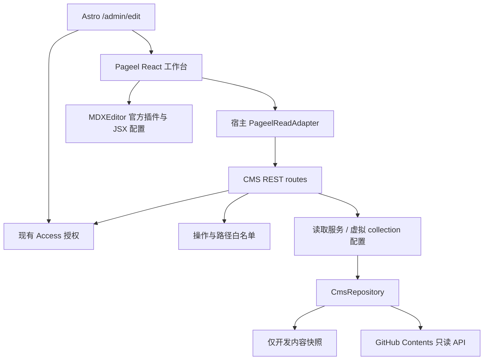

# Pageel 文章后台接入 Spec

- 日期：2026-10-22
- 状态：设计待原型验证，尚未安装或部署 Pageel。
- 决策：退役本站自建文章工作台；复用 Pageel 完整 React 工作台，集成现有 Astro / Cloudflare Worker。通过固定版本的上游源码包与小型适配补丁维护，不拆散复制后重建同类后台。
- 需求来源：[Blog CMS PRD](../blog-cms-prd.md)。本文替代旧 PRD 中的自建工作台、文章 REST API 和 Worker 写入实现方案。

## 1. 目标与范围

提供文章列表、属性表单、正文可视化编辑、源码恢复、媒体管理和 Git 保存。博客保留 MD/MDX，Stories 仅允许纯文字 MD。公开网站继续使用现有 Astro 5、React islands、内容集合和 Cloudflare Worker。

硬约束：管理员仅通过 Cloudflare Access 登录；GitHub 凭证仅在 CMS 服务端；不出现 GitHub OAuth、粘贴 token 或额外 CMS 密码流程。原有文章路径、URL、语言、未知字段和组件语义必须保留。

允许的适配仅限：认证桥接、集合与组件配置、必要的保存校验和小型上游修复。不自建富文本内核、差异算法、媒体库、文章工作台或 MDX 转换器。若缺口需要这些开发，判定选型不通过。

## 2. 源码核查基线

上游：[pageel/pageel-cms](https://github.com/pageel/pageel-cms)。核查 commit：`545483babb0258b9493dcc844856ff9326bd592d`。后续原型固定该 SHA，并保存依赖锁文件；升级必须重新跑兼容性样本。

以下是源码阅读结果，不是运行验收：

| 核查位置 | 结论 | 设计影响 |
| --- | --- | --- |
| `package.json`、`astro.config.mjs` | Astro 6 / React 19，SSR，默认 Vercel adapter；注释给出 Node 部署方向 | 不引入上游 Astro 宿主；提取上游完整客户端构建入口，保留本站 Astro 5 宿主；Worker 兼容性必须实测 |
| `packages/cms-bridge/src/index.ts` | 扫描目录、生成 `.pageelrc.json`、注入跳转路由；不负责托管完整后台，也不解析 Zod 全部字段 | 不将安装 `@pageel/cms` 当作完整接入；显式配置集合 |
| `packages/plugin-mdx/package.json` | 插件 0.2.6，依赖 MDXEditor `^3.20.0` | 不套用本站此前 4.x 的兼容性结论 |
| `packages/plugin-mdx/src/MdxSlot.tsx` | 已接入基础格式、图片和代码块；没有配置 JSX、表格、公式插件；onChange 有 300ms 防抖 | “MDX 插件”不等于支持本站复杂 MDX；快速保存和切换须验证 |
| `packages/plugin-types/src/index.ts` | 提供 editor/toolbar/preview slots 和受限图片服务接口 | 可采用官方插件扩展点；不复制整个编辑器 |
| `src/middleware.ts` | 校验 CMS session、Git 凭证和 mutation CSRF | Access 不能仅放在外层后删掉现有保护 |
| `src/lib/auth-bridge.ts` | 对接 Pageel SaaS bridge，不是 Cloudflare Access provider | 需独立 Access 适配；不启用 SaaS 登录 |
| `src/services/proxyGitService.ts`、`src/hooks/usePostActions.ts` | 页面通过代理请求保存，更新携带 SHA | 复用服务端 Git 流程；实际冲突行为待测 |
| `packages/cms-bridge/src/index.ts` | 文件写入用于配置生成 | 不能据此宣称支持本地文章写盘 |
| `src/hooks/useSessionRestore.ts` | 有清理 localStorage 的逻辑 | 不能把编辑防抖等同于持久化草稿；须验证登录恢复与草稿关系 |

项目声明 MIT；分发时保留上游 LICENSE 与 notices。上游 README 的功能描述仅作线索，以上 SHA 的实现与原型结果优先。

## 3. 现有 Cloudflare 架构与接入设计

**同一项目、同一 Cloudflare Worker、同源后台和 API。无需独立 Node 服务、VPS、容器或第二个 CMS 域名。**本节取代前版独立 Node 设计。

### 3.1 已有基础设施（本地代码核实）

| 已有实现 | 复用方式 |
| --- | --- |
| `astro.config.mjs`：Astro 5、`output: server`、Cloudflare adapter、React / MDX 集成 | 保留现有宿主，不整站升级到上游 Astro 6 |
| `wrangler.toml`：`dist/_worker.js`、ASSETS、`nodejs_compat`、compatibility date 2026-03-31 | 同一构建、同一 Worker 部署；不认为 nodejs_compat 等同完整 Node 环境 |
| D1 `DB`、业务缓存 `KV`、Astro `SESSION` | 首版不新增文章数据库或 CMS session 存储；文章继续以 Git 文件为事实来源 |
| `src/server/env.ts` 的 `getServerEnv` | 从请求 runtime bindings 读取 CMS secret，避免构建期内联 |
| `src/server/security/access/` | 复用 Access JWT、管理员身份、capabilities 与本地开发策略 |
| `src/server/rest/` | 复用请求上下文、request ID、错误响应与 no-store |
| `src/server/admin/session/routes.ts` | 使用现有管理员会话响应初始化 CMS 身份 |
| `.github/workflows/deploy.yml` | 沿用 GitHub Actions 构建和 Worker 发布 |

```mermaid
flowchart TD
    Browser[管理员浏览器] --> Access[现有 Cloudflare Access]
    Access --> Site[现有 Astro / Cloudflare Worker]
    Site --> UI[/admin/edit: Pageel React 工作台]
    UI --> API[/api/v1/admin/cms/*]
    API --> Auth[现有 authorizeAdmin / authorizeAdminMutation]
    Auth --> GitClient[Pageel Git 客户端 + Worker 适配]
    GitClient --> GitHub[固定 GitHub 仓库]
    GitHub --> Actions[现有 deploy.yml]
    Actions --> Site
```

### 3.2 上游复用方式

上游 `src/pages/cms.astro` 使用 `CmsClient client:only="react"`，`App.tsx` 是 React 工作台；不需要把上游 Astro 6 服务整体搬进来。`@pageel/cms` 是跳转/配置桥接，不能作为可嵌入完整后台的 npm 包使用。

原型阶段将固定 SHA 的源码置于独立 vendor/package 边界，保留上游目录结构、LICENSE、版本清单与补丁记录；基于上游客户端入口构建一个可由本站导入的浏览器模块。它是现有工作台的打包适配，不新增文章列表或编辑器实现。正式维护方式优先固定 fork commit / 内部制品；不得追踪浮动 main。

建议新增边界（均为计划，当前未创建）：

- `packages/pageel-workbench/`：完整上游 React UI、插件及构建配置；与本站共享兼容的 React 单实例，不引入上游 Vercel/Node adapter。
- `src/pages/admin/edit.astro`：动态页面，请求时检查 admin:read；加载客户端工作台，禁止 prerender。
- `src/lib/admin/pageel-adapter.ts`：统一 API 前缀、会话映射、错误响应映射；不重建编辑状态管理。
- `src/server/admin/cms/`：Pageel Git 操作适配与本站权限/内容约束。
- `src/pages/api/v1/admin/cms/`：薄路由，复用现有 REST 框架。

Pageel 会操作 body class 并自带全屏布局/CSS；编辑页采用独立文档布局，保持“返回管理后台”入口，不嵌套在 AdminShell 的双侧栏中。CSS 仅在编辑路由加载；不得影响公开文章及友链后台。动态编辑路由中的客户端脚本不包含 Git 凭证。

### 3.3 路由与服务契约

| 对外入口 | 来源/职责 | 权限 |
| --- | --- | --- |
| `/admin/edit` | Pageel 完整工作台 | admin:read |
| 现有 admin session API | 初始化 actor/capabilities | 现有鉴权 |
| `/api/v1/admin/cms/git` | 适配上游 `/api/proxy/git` 操作 | 读操作 admin:read，写操作 admin:write |
| `/api/v1/admin/cms/upload` | 上游上传流程与固定媒体目录校验 | admin:write |
| `/api/v1/admin/cms/blob/...` | 部署前受保护媒体读取 | admin:read |
| `/api/v1/admin/cms/config` | 返回版本化集合配置，首版只读 | admin:read |

上游 ProxyGitService 中 `/api/proxy/*` 是硬编码后缀，仅设置 baseUrl 不足以得到目标路径；必须通过一个小型上游补丁或 transport adapter 统一改写所有 git/upload/blob/settings/session URL。不能只改一个请求留下未受保护旧端点。

HTTP POST 的 git dispatcher 可能同时承载查询与写入，必须先对 operation 做白名单分类；读取需要身份授权，写入还需要 authorizeAdminMutation。未知 operation、删除、移动、改配置、切换仓库/服务商/分支默认拒绝。路径与内容约束在服务器执行，不以隐藏 UI 代替。

沿用本站 JSON envelope；客户端适配层负责转成 Pageel 期望结构，并保留 401/403/409 的语义，媒体端点返回二进制。冲突使用真实基准 SHA，禁止自动读最新 SHA 后覆盖重试。

### 3.4 Worker 运行时适配

- 上游 `src/lib/git-client.ts` 核心使用 fetch；复用其 API 操作，显式传入固定 GitClientConfig，替换 `import.meta.env` 凭证回退。
- 在 `CloudflareEnv` 与 `getServerEnv` 增加专用 Git token/repo/branch 配置。token 为 Worker Secret；仓库/分支由服务端固定。客户端不能提交 token、远端主机或任意 fetch URL。
- 上游 upload 使用 File、arrayBuffer、Uint8Array，可先沿用并使用现有 bounded body 工具限制读取；在 workerd 验证 multipart、二进制编码和媒体响应。
- 配置扫描、插件打包只发生在开发/CI。生产不执行 node:fs 写仓库、不启动 shell/git、不动态 npm install，也不从任意 URL 加载插件。
- Workers 的 node:fs 是虚拟文件系统，临时写入不是持久化 Git checkout；线上文章与图片写入 GitHub，不能依靠 `/tmp` 保存。
- 首版不引入 D1 草稿表、KV 文件存储、R2 或新的 SESSION 用法。已有资源不等于必须用于 CMS；若后续明确需跨设备草稿，再单独设计。
- 在现有 compatibility date 下做 wrangler dry-run 和 workerd 冒烟测试；只有出现确切 API 缺口才考虑升级日期/flag，并回归现有服务。

## 4. 复用现有 Access 认证

不引入 Pageel 密码登录、CMS_SECRET session、SaaS bridge 或 GitHub OAuth。适配其客户端初始化为现有 AdminSession，将 actor、capabilities、固定仓库描述映射给 Pageel store；Git token 不进入 store。

1. 页面和每个 API 独立调用现有鉴权函数；不能只依赖页面入口。
2. 读取使用 `authorizeAdmin(..., 'admin:read')`；所有写操作使用 `authorizeAdminMutation(..., 'admin:write')`，继续校验浏览器 Origin。
3. Pageel session/CSRF 依赖在 transport/auth 适配边界统一替换为本站现有 Access + 同源策略；这是替换整套安全机制，不能只删除 CSRF header 检查却保留不受保护的写接口。
4. 沿用本地 `local-development` 认证与站点 origin 限制，生产不能启用开发豁免。
5. `/admin/edit` 与 `/api/v1/admin/cms/*` 位于已有 Access 路径命名空间。上线仍要复核云端策略实际生效，不能把本地设计文档当作当前控制台事实。
6. 上游 logout/session restore 中的 `localStorage.clear()` 必须替换为仅处理 CMS 自有命名空间；同源部署不能清除本站其他应用状态。退出沿用项目现有 Access 退出方式，不能调用未部署的 `/api/auth/logout`。

验收：过期/伪造 JWT、错误 audience、非管理员、只读用户写入、跨 Origin 与缺失 Origin 的浏览器写入均拒绝；无第二次登录；未知端点不存在；Git token 不进入网络响应和客户端产物。

## 5. 内容配置

| 集合 | 文件与命名 | 字段 | 限制 |
| --- | --- | --- | --- |
| Blog | 保留 `content/blog/**/*.md` / `*.mdx`；新中文文件使用 `-zh` 后缀 | title、description、pubDate、updatedDate、tags、draft、lang、heroImage、shareText、llms | 语言来自 frontmatter；旧文件不重命名 |
| Stories | `content/stories/**/*.md`，不自动添加语言后缀 | title、description、pubDate、updatedDate、tags、draft、lang、已有 llms | 禁用标题、代码、图片、公式和组件插入；保留 `<br/>` 与场景分隔 |

- 字段默认值与 `src/content.config.ts` 一致，特别是 `llms`；现有中文标签不得被英文 slug 规则拦截。
- 集合模板使用 Pageel 已有配置格式；实施时核对类型后再提交 `.pageelrc.json`，本 spec 不虚构可运行配置。
- 当前 Astro stories loader 也匹配 MDX，但本 CMS 仍遵守仓库纯 MD 内容规则；不修改公开集合 schema。
- Blog 中文 URL 去除 ID 末尾 `-zh`；Stories 不去除。创建前校验不同扩展名和语言后缀归一化后的 URL 冲突。
- 更新不丢未知字段、不截断日期时间；不编辑正文时正文应保持不变。YAML 注释/序列化变化须记录并人工评估，不能宣称字节无损。

## 6. 编辑与预览

直接使用 Pageel 工作台与官方 MDX 插件。缺少的表格、源码/diff、JSX 仅通过 MDXEditor 官方插件及通用属性编辑器配置；优先向上游提交配置扩展支持。若必须维护另一套 editor slot，先判定是否违反“不自建”的范围，不能默默重做现有实现。

组件样本至少包含 ExploreCard、PreviewLink、BlockQuote、Cite、References，以及 `client:load` / `client:visible`、命名 imports、嵌套 JSX、数组/对象属性。普通 Markdown 与常用 ExploreCard 应可视化编辑；复杂内容可明确进入上游源码模式，但不得静默丢节点，也不得所有 MDX 都退回源码。

预览分为两类：Pageel 内置预览只声明其已验证的 Markdown 能力；完整交互组件与 hydration 以实际 Astro 构建预览为准。不另写 MDX 到 HTML 转换器。未保存的完整页面预览若上游不具备，记录为缺口，不宣称已有。

公式是单独门槛：验证 `$` / `$$` 在可视化修改其他段落后仍能保留并正确构建。不因 KaTeX 预览可见就判定编辑支持通过。

## 7. 图片、草稿与发布

### 图片

复用 Pageel 媒体库与插件上传接口。存储在 `public/images/blog/` 允许目录，正文保存 `/images/blog/...`；验证部署前后台读取和粘贴/拖放。Stories 禁止上传。第三方图片来源仍须按仓库规则登记 `src/data/imageCredits.ts`；首版通过现有代码流程登记，不能用 CMS 上传自动替代。

图片与正文是否分成多次提交由原型确认。失败时保留编辑内容并提示已上传但未引用的资产，不自动删除用户文件。

### 草稿

区分浏览器临时编辑、仓库 `draft:true`、公开文章三个状态。禁止将已发布文章“暂存”实现为改成 `draft:true`。Pageel 持久化恢复、跨页面切换和冲突 diff 尚未验收；若无现成功能，必须记录阻塞，不能重新实现整套草稿系统。

### 发布

首版沿用 PRD 的直接提交 main 语义：CMS 保存成功表示 Git 提交成功，实际上线由现有 `.github/workflows/deploy.yml` 完成。构建失败时 Git 已修改、线上仍可能是旧版本；通过现有 Git 工作流修复或 revert。

优先使用 GitHub Actions 页面查看部署结果，不重建自定义轮询徽章。将来显示“已上线”时必须依据该 commit 的指定工作流成功；Pageel 保存提示不能冒充部署成功。PR 预览发布作为独立后续决策，本轮不更改 CI。

## 8. PRD 差距与决策门槛

| 要求 | 当前判断 | 处理 |
| --- | --- | --- |
| 完整文章/媒体工作台 | 上游已有 | 直接复用 |
| Access 唯一登录 | 现有服务端能力可复用，需适配 Pageel 初始化 | 使用本站 AdminSession 和 authorizeAdminMutation 后验收 |
| 现有 JSX、表格、公式 | 默认插件不足 | 官方插件配置原型；不允许静默降级 |
| 本地服务端直接写文章文件 | 本轮未找到现成支持 | 保留为未满足硬约束；不能将本地连接 GitHub 当成本地写盘 |
| 同一 Worker 内运行 CMS | 目标部署约束，待原型验证 | 客户端复用 Pageel，服务端适配现有 REST/Access；不改为独立 Node |
| 浏览器暂存与冲突恢复 | 未验证 | 作为采用门槛 |
| 完整未保存 Astro 预览 | 未验证 | 明确缺口；不自建转换器 |

若本地写盘或复杂 MDX 需要大规模新增实现，Pageel 不通过选型。此时输出明确取舍供用户决定（如放宽本地模式或改选成熟方案）；不得擅自放宽需求，也不得恢复自建后台。源码核查完成不等于批准生产迁移。

## 9. 实施阶段与验收

1. **清理（本轮）**：移除自建编辑器、文章 API、专用测试/契约、导航接入及专用依赖；保留原内容、公开页面、原后台和本文档。
2. **隔离原型**：固定上游 SHA，在本站 Astro 5 宿主构建 Pageel 完整客户端，API 挂现有 Worker；使用测试仓库和独立测试环境，无生产凭证。执行 wrangler dry-run、workerd 请求测试和客户端包扫描。
3. **编辑兼容性**：复制全部现有文章，执行打开→切换视图→修改普通段落→立即保存→重开；比较 metadata/body diff 并运行本站构建。无操作打开不得产生提交。
4. **接入验证**：Access/session/CSRF、固定仓库和路径限制、图片预览、双窗口 SHA 冲突、网络失败、300ms 内保存和切换、中文输入法、手机布局、草稿恢复。
5. **决策评审**：逐项列出通过/未通过/所需补丁；本地写盘和公式等缺口不得用“基本可用”关闭。
6. **正式接入**：验证通过并确认部署资源后，添加 `/admin/edit` 导航入口和 Worker Secrets，复核现有 Access 路径；经授权执行一篇测试内容发布，核对 Git SHA、Actions 和公开 URL。

验收样本：`astro-to-nuxt-ecosystem-fullstack.md`（表格/代码）、`ai-draft-generation-queue-sse-guide.mdx`（ExploreCard/长文）、`miles.mdx` / `miles-zh.mdx`（复杂 JSX）、`fragment.md` / `fragments.md`（中文标签/换行/强调）；补充多行 YAML、未知字段、公式、非法 MDX 和不支持组件。

设计阶段未创建 CMS 路由；随后实施状态以第 12 节为准。

上线失败回退：撤下 CMS 入口、移除 Worker 中 CMS 写入凭证，继续原 Git/本地代码编辑流程；必要时通过普通 Git revert 回退具体内容提交。无需恢复已退役自建工作台。

## 10. 参考与证据

- [固定版本上游源码](https://github.com/pageel/pageel-cms/tree/545483babb0258b9493dcc844856ff9326bd592d)
- [MDX 插件实现](https://github.com/pageel/pageel-cms/blob/545483babb0258b9493dcc844856ff9326bd592d/packages/plugin-mdx/src/MdxSlot.tsx)
- [Astro 集成桥接实现](https://github.com/pageel/pageel-cms/blob/545483babb0258b9493dcc844856ff9326bd592d/packages/cms-bridge/src/index.ts)
- [上游认证中间件](https://github.com/pageel/pageel-cms/blob/545483babb0258b9493dcc844856ff9326bd592d/src/middleware.ts)
- [MDXEditor JSX](https://mdxeditor.dev/editor/docs/jsx)、[源码与 diff](https://mdxeditor.dev/editor/docs/diff-source)

## 11. 本地模式与实施顺序补充

### 本地与线上持久化边界

“CF 全栈部署”是生产运行约束；开发/CI 使用 Node 构建工具不等于单独部署 Node 服务。现有 PRD 的本地直接写仓库文件仍需独立验证：

- 生产和 workerd 集成测试：统一 GitHub adapter，测试指向隔离仓库；本地测试不能写生产 main。
- 本地直写需求：仅在 `pnpm dev` 宿主允许真实磁盘访问时，评估复用成熟本地 Git/文件 adapter 或上游实现；不得将 workerd 虚拟 fs 当作宿主 checkout。
- 本轮没有找到 Pageel 现成本地文章 adapter。该项继续标记未满足，不自动改为云端写入；若必须重新开发一套存储系统，停止并提交取舍，不恢复旧自建 API。

### 原型顺序与停止条件

1. 先验证 Pageel 完整客户端可在本站 Astro 5/React 19 构建、按路由隔离样式，无上游服务器依赖泄漏。
2. 验证现有 session 初始化和单个受保护 Git 读取，再接保存/上传；不整体复制上游 middleware 和 API。
3. 验证 workerd 中 fetch、编码、上传以及请求时 secret 注入，生产 bundle 无 fs 写入和 Node server adapter。
4. 再执行第 9 节全部内容与发布验收。JSX、表格、公式以及本地写盘的缺口仍然有效，CF 适配成功不代表 CMS 选型完成。
5. 若适配扩大到重写 Dashboard、编辑器内核、草稿系统或内容序列化器，判为 Pageel 不适合本约束，输出证据；不得以独立 Node 部署绕过用户要求。

新增验证：构建前后公开页面/友链 API 不受影响；编辑器 chunk 不进入公开路由；同源 logout 不清空其他功能存储；所有 CMS 请求落入 `/api/v1/admin/cms/*`；read/write capability 和 Origin 策略在 workerd 中有效；管理员 API 与媒体 `Cache-Control: no-store`。

Cloudflare 官方运行时依据：[Node 兼容性](https://developers.cloudflare.com/workers/runtime-apis/nodejs/)、[虚拟文件系统](https://developers.cloudflare.com/workers/runtime-apis/nodejs/fs/)。原型通过前，本 spec 不宣称 Pageel 官方已支持本站 Cloudflare 部署。

## 12. 首轮实施记录（2026-10-22）

已开始按模块实现；当前为**禁止持久化的兼容性原型**，不是可上线 CMS。

- 上游边界：`packages/pageel-workbench/`，保留固定 SHA、MIT LICENSE 和补丁台账。
- 页面：`/admin/edit`，现有 Worker 动态路由，现有 Access 授权，独立文档/CSS。
- 客户端：`src/lib/admin/pageel-adapter.ts`，复用 adminApiRequest。
- 服务端：`src/server/admin/cms/{config,policy,repository,service,routes}.ts`。
- 读取 API：`/api/v1/admin/cms/git`、`/api/v1/admin/cms/session`，只读操作白名单。
- 本地：开发模式提供服务器端内容快照；不是文件写入。生产构建排除快照，缺少 GitHub 配置时拒绝读取。
- 保存、上传、删除、改配置在客户端和服务端均拒绝；尚未实现写入开关。可在内存中试编辑，页面明确提示离开即丢弃。
- 固定 MDXEditor 3.20.0；默认上游插件确实不能完整导入本站长文，已追加官方表格/代码/JSX 插件和原文错误恢复；完整无损往返仍待验收。
- 此次只读 GitHub transport 为小型宿主适配，尚未接入上游写操作，不宣称完整发布链路完成。

模块维护与升级方式见 [工作台 README](../../packages/pageel-workbench/README.md)。原型若证明需要重写编辑器或序列化器，依第 11 节停止扩展，不以开放写入绕过验收。


### 12.1 实际验证与停止条件

2026-10-22，在本地 `/admin/edit` 使用真实文章的只读快照验证：

| 验证项 | 结果 | 后续处理 |
| --- | --- | --- |
| Astro 5 / React 19 加载完整上游列表与编辑视图 | 通过 | 保留 client-only 边界 |
| 长文表格、代码块、ExploreCard 导入 | 官方插件配置后可打开 | 全量语义 diff 与保存重开尚未验收 |
| `miles-zh.mdx` 嵌套 JSX、hydration 属性、profile 对象 | 切换 Source 后保留 | descriptor 必须配置 source/defaultExport 与真实 props |
| 仅打开文章不产生修改状态 | 未通过 | MDXEditor 归一化触发 dirty；禁止据此创建提交 |
| 只改标题保留其他原文 | 未通过 | 上游 updateFrontmatter 丢 YAML 注释、改变日期格式并 trim 正文 |
| 公式样本 `$x^2$`、`\frac{1}{2}` | 样本文本往返保留，但没有数学编辑/渲染 | 不视为公式支持通过 |
| Worker 打包 dry-run | 通过 | 未部署，不能替代 workerd 请求验收 |
| 写入与越界路径保护 | 新增 5 项单测通过 | 所有变更操作在两端拒绝 |

frontmatter 最小复现：含 `title: "Sample" # retain comment`、日期 `2026-10-22` 和正文前后空行的文件，经上游 `updateFrontmatter(content, {title: 'Changed'})` 后，注释丢失、日期变为 `2026-10-22T00:00:00.000Z`、正文空白被 trim；未知字段仍保留。不能把未知字段保留等同于无损保存。

根据第 11 节停止条件，当前暂停扩展保存、媒体上传和发布模块。继续开发前需要采用可保留源文的成熟序列化能力，或明确调整原文保真验收标准；不能为了完成发布接口而默认接受内容重写。源文模式也不能绕过 frontmatter 序列化问题。

### 12.2 已落地模块依赖



后续模块按依赖顺序实施：编辑保真门槛 → 写操作与 SHA 冲突 → 媒体上传/引用 → 发布状态与恢复。当前没有为这些未通过前置验收的功能放置伪实现或开放写入入口。生产运行继续只有现有 Cloudflare Worker，无新增 Node 服务。


### 12.3 工作台入口与界面优化

按用户后续明确要求，后台统一导航已增加“文章工作台 / 验证中”，以完整页面导航进入独立工作台；此入口不代表正式发布验收通过。

界面继续复用 Pageel。宿主样式和中文映射集中在 `packages/pageel-workbench/integration/`：正文限宽、属性折叠、继承后台主题、中文字段和工具栏。集合切换会卸载旧文章视图；同源 public 图片不再走上游不存在的代理；禁止持久化的按钮明确禁用，状态显示“仅内存编辑”。发布与保真阻塞保持不变。


### 12.4 后台嵌入与模块边界（2026-10-23）

`/admin/edit` 现已使用 AdminLayout 和 AdminApp；后台导航改为 SPA 模块切换。
ArticlesAdmin 懒加载 package 公共入口，复用宿主会话并注入同源适配器。
Pageel Dashboard 的 embedded 模式仅保留内容管理区域，宿主管理导航、账户和主题。
自定义组件、样式、中文映射与 JSX 描述均位于 integration，不新增 upstream/custom。
上游保留必要的小型扩展参数和状态回调补丁；关键生命周期、样式和鉴权边界添加中文注释。

写入、媒体上传、发布继续关闭。离开保护不替代草稿恢复和保存保真验收。


### 12.5 项目组件编辑模块

组件接入由项目配置控制，详细边界见下方“项目组件配置与编辑台适配”。
已建立注册表、局部属性更新、选择上下文、原生编辑适配与右栏表单；
Highlighter / PreviewLink 支持字面量参数编辑及当前编辑器内撤销。
真实交互预览和复杂表达式表单仍待验证，保存保真门槛保持不变。


## 13. 项目组件配置与编辑台适配

更新：2026-10-23。适用于当前只读持久化验证阶段。

### 13.1 产品边界

正文文字直接编辑；组件参数在右侧“当前组件”配置；“文章属性”仍管理 frontmatter。
真实项目组件不挂载到 contenteditable 内，不执行动画、导航、远程 hover 请求。
编辑态样式只是近似表达，当前 marked 预览不是 Astro MDX 真实预览。

当前文章使用的 5 个组件已全部配置接入。Highlighter 的 action/color、PreviewLink 的 href、ExploreCard 的 title、TechSkillsCloud 的 headingId、TechStackTerminal 的 successMessage 支持属性表单；profile 对象表达式继续源码编辑。
插入组件菜单、选区包裹、高级组件表单、真实交互预览均尚未实现，不能据此开放发布。

### 13.2 目录与职责

```text
src/config/content-components.ts      项目已有组件的单一接入配置
packages/pageel-workbench/integration/
  component-config.ts                宿主配置适配边界
  jsx-descriptors.ts                 配置 → MDXEditor descriptor
  jsx-attributes.ts                  AST 字面量局部更新及配置驱动校验
  components/
    InspectorContext.tsx             选中状态与 portal 挂载点
    RegisteredJsxEditor.tsx           官方节点适配
    ComponentProperties.tsx          配置生成属性表单
```

不建立单独的 component-editing 目录，也不复制现有业务组件。组件源码保持原位置。
配置声明 name、source、defaultExport、kind、hasChildren、enabled 和 fields。
fields 声明名称、中文标签、控件类型、选项、必填和占位提示，表单与校验共同消费。
enabled 控制属性编辑接入；关闭时仍保留识别描述符，避免旧文章失去节点识别。
目前没有组件插入菜单，因此此开关不声称控制尚未实现的插入行为。
后续组件库列表应只展示 enabled 项；当前文档列表应显示所有实际使用项（含停用状态）。
纯 Markdown stories 不开放项目组件；现有服务端集合规则保持不变。

- attributes 不解析/序列化 MDX，只在官方传入的 AST 上替换明确属性。
- InspectorContext 不存正文、属性副本或持久化草稿；每个文章详情实例独立。
- RegisteredJsxEditor 复用 GenericJsxEditor 的子内容编辑能力及 useMdastNodeUpdater。
  关闭通用 PropertyPopover，避免其重建全部 attributes。
- ComponentProperties 经 portal 显示在右栏，仍属于原节点 React 生命周期；
  表单应用直接更新当前官方节点，不注册全局回调，不维护第二套编辑历史。
- 上游 PostList 只增加 Provider；PostDetailView 只增加面板挂载点和显示模式。

### 13.3 交互规则

1. 点击组件内文字或键盘聚焦，选中最近一层组件，右栏切到“当前组件”。
2. 嵌套节点停止向外传播选择事件，PreviewLink 与外层 Highlighter 可分别选择。
3. 配置按钮在悬停/聚焦时显示，提供明确名称；不拦截普通文字输入。
4. 表单修改后点击“应用参数”，修改进入 Lexical 撤销历史；不是保存到仓库。
5. 切回文章属性不清空节点；切换源码/文章、节点卸载时清空已选节点，避免悬挂引用。
6. 未点击应用的表单输入属于临时输入，切换组件会丢弃；不是自动保存。
7. 正文与右栏桌面独立滚动，窄屏仍按现有单列布局处理。

### 13.4 保真规则

- 只更新注册且开放的属性，未知属性、client:* 布尔属性、其他表达式原样保留。
- 不修改 children、导入声明或节点类型；文字更新交给官方嵌套编辑器。
- 属性是表达式、有重复名称、或节点带 spread 时，普通表单禁止修改；提示使用源码。
- action 校验枚举，color 首阶段支持十六进制；href 支持 http(s)、站内路径与锚点。
- 已有但不在表单允许值范围内的字面量不自动转换；未改动的属性不回写。
- 清空可选参数表示删除以恢复默认值；必填 title/href 拒绝清空。
- 这些规则只覆盖组件属性更新，不解决上游 frontmatter 重写和整个文档归一化问题。

### 13.5 后续扩展与预览

按顺序扩展：

1. 配置扩展：新增字段按实际组件 props 声明；数字、布尔和对象表达式暂不做自动转换。
2. TechStackTerminal：profile 对象需要独立验证结构化表达式能力；不可用 eval 或正则修改。
3. 插入菜单：使用 MDXEditor 官方 insertJsx$；默认 import/hydration 来自注册表。
   选区包裹需验证官方 selection API，不通过字符串切片处理嵌套 MDX。
4. 真实预览：独立 iframe 与预览构建链路，明确草稿输入、资源解析、错误返回和生命周期。
   需单独验证 Cloudflare 运行约束与未保存 MDX 编译方案；本轮不创建假预览接口。

### 13.6 验证结果

- 三项定向测试：局部更新保留未知/布尔/表达式属性；拒绝不确定属性覆盖；白名单值校验。
- miles-zh 浏览器验证：修改 color 后 client:load、action、四个 import、profile 对象仍在。
- 原生撤销/重做同步回右侧颜色表单；嵌套 PreviewLink 可独立选中。
- 本次验证颜色已恢复。未提交文章内容，未启用保存与发布。
- 撤销仅在当前编辑器生命周期内验证；跨源码切换的历史、手机交互、全量组件兼容性待验收。
