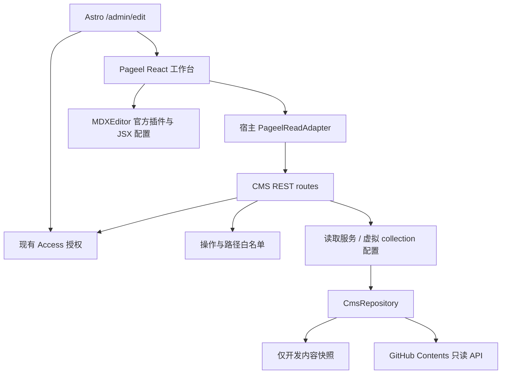

# Pageel 文章后台接入 Spec

- 日期：2026-10-22
- 状态：Pageel 文章管理后台已全面升级为 Cloudflare D1 原生发布架构与生产全闭环状态（见第 18 节）。文章创建、草稿暂存、发布、再次编辑更新发布及受控下线均直接在 D1 数据库与对象存储闭环运行；前台 SSR 双轨合流保障历史静态文章与动态 D1 文章无缝并存。开发阶段临时文案已完成生产化清理，101 项服务端测试与生产构建全部通过，系统已完全就绪上线。
- 决策：退役本站自建文章工作台；复用 Pageel 完整 React 工作台，集成现有 Astro / Cloudflare Worker。通过固定版本的上游源码包与小型适配补丁维护，不拆散复制后重建同类后台。
- 需求来源：[Blog CMS PRD](../blog-cms-prd.md)。本文替代旧 PRD 中的自建工作台、文章 REST API 和 Worker 写入实现方案。

## 1. 目标与范围

提供文章列表、属性表单、正文可视化编辑、源码恢复、媒体管理和 Git 保存。博客保留 MD/MDX，Stories 仅允许纯文字 MD。公开网站继续使用现有 Astro 5、React islands、内容集合和 Cloudflare Worker。

硬约束：管理员仅通过 Cloudflare Access 登录；GitHub 凭证仅在 CMS 服务端；不出现 GitHub OAuth、粘贴 token 或额外 CMS 密码流程。原有文章路径、URL、语言、未知字段和组件语义必须保留。

允许的适配仅限：认证桥接、集合与组件配置、必要的保存校验和小型上游修复。不自建富文本内核、差异算法、媒体库、文章工作台或 MDX 转换器。若缺口需要这些开发，判定选型不通过。

## 2. 源码核查基线

上游：[pageel/pageel-cms](https://github.com/pageel/pageel-cms)。核查 commit：`545483babb0258b9493dcc844856ff9326bd592d`。后续原型固定该 SHA，并保存依赖锁文件；升级必须重新跑兼容性样本。

以下是源码阅读结果，不是运行验收：

| 核查位置 | 结论 | 设计影响 |
| --- | --- | --- |
| `package.json`、`astro.config.mjs` | Astro 6 / React 19，SSR，默认 Vercel adapter；注释给出 Node 部署方向 | 不引入上游 Astro 宿主；提取上游完整客户端构建入口，保留本站 Astro 5 宿主；Worker 兼容性必须实测 |
| `packages/cms-bridge/src/index.ts` | 扫描目录、生成 `.pageelrc.json`、注入跳转路由；不负责托管完整后台，也不解析 Zod 全部字段 | 不将安装 `@pageel/cms` 当作完整接入；显式配置集合 |
| `packages/plugin-mdx/package.json` | 插件 0.2.6，依赖 MDXEditor `^3.20.0` | 不套用本站此前 4.x 的兼容性结论 |
| `packages/plugin-mdx/src/MdxSlot.tsx` | 已接入基础格式、图片和代码块；没有配置 JSX、表格、公式插件；onChange 有 300ms 防抖 | “MDX 插件”不等于支持本站复杂 MDX；快速保存和切换须验证 |
| `packages/plugin-types/src/index.ts` | 提供 editor/toolbar/preview slots 和受限图片服务接口 | 可采用官方插件扩展点；不复制整个编辑器 |
| `src/middleware.ts` | 校验 CMS session、Git 凭证和 mutation CSRF | Access 不能仅放在外层后删掉现有保护 |
| `src/lib/auth-bridge.ts` | 对接 Pageel SaaS bridge，不是 Cloudflare Access provider | 需独立 Access 适配；不启用 SaaS 登录 |
| `src/services/proxyGitService.ts`、`src/hooks/usePostActions.ts` | 页面通过代理请求保存，更新携带 SHA | 复用服务端 Git 流程；实际冲突行为待测 |
| `packages/cms-bridge/src/index.ts` | 文件写入用于配置生成 | 不能据此宣称支持本地文章写盘 |
| `src/hooks/useSessionRestore.ts` | 有清理 localStorage 的逻辑 | 不能把编辑防抖等同于持久化草稿；须验证登录恢复与草稿关系 |

项目声明 MIT；分发时保留上游 LICENSE 与 notices。上游 README 的功能描述仅作线索，以上 SHA 的实现与原型结果优先。

## 3. 现有 Cloudflare 架构与接入设计

**同一项目、同一 Cloudflare Worker、同源后台和 API。无需独立 Node 服务、VPS、容器或第二个 CMS 域名。**本节取代前版独立 Node 设计。

### 3.1 已有基础设施（本地代码核实）

| 已有实现 | 复用方式 |
| --- | --- |
| `astro.config.mjs`：Astro 5、`output: server`、Cloudflare adapter、React / MDX 集成 | 保留现有宿主，不整站升级到上游 Astro 6 |
| `wrangler.toml`：`dist/_worker.js`、ASSETS、`nodejs_compat`、compatibility date 2026-03-31 | 同一构建、同一 Worker 部署；不认为 nodejs_compat 等同完整 Node 环境 |
| D1 `DB`、业务缓存 `KV`、Astro `SESSION` | 只读原型未使用 D1；第 17 节将现有 D1 用于非公开工作草稿，Git 文件仍是站点构建来源 |
| `src/server/env.ts` 的 `getServerEnv` | 从请求 runtime bindings 读取 CMS secret，避免构建期内联 |
| `src/server/security/access/` | 复用 Access JWT、管理员身份、capabilities 与本地开发策略 |
| `src/server/rest/` | 复用请求上下文、request ID、错误响应与 no-store |
| `src/server/admin/session/routes.ts` | 使用现有管理员会话响应初始化 CMS 身份 |
| `.github/workflows/deploy.yml` | 沿用 GitHub Actions 构建和 Worker 发布 |

```mermaid
flowchart TD
    Browser[管理员浏览器] --> Access[现有 Cloudflare Access]
    Access --> Site[现有 Astro / Cloudflare Worker]
    Site --> UI[/admin/edit: Pageel React 工作台]
    UI --> API[/api/v1/admin/cms/*]
    API --> Auth[现有 authorizeAdmin / authorizeAdminMutation]
    Auth --> GitClient[Pageel Git 客户端 + Worker 适配]
    GitClient --> GitHub[固定 GitHub 仓库]
    GitHub --> Actions[现有 deploy.yml]
    Actions --> Site
```

### 3.2 上游复用方式

上游 `src/pages/cms.astro` 使用 `CmsClient client:only="react"`，`App.tsx` 是 React 工作台；不需要把上游 Astro 6 服务整体搬进来。`@pageel/cms` 是跳转/配置桥接，不能作为可嵌入完整后台的 npm 包使用。

原型阶段将固定 SHA 的源码置于独立 vendor/package 边界，保留上游目录结构、LICENSE、版本清单与补丁记录；基于上游客户端入口构建一个可由本站导入的浏览器模块。它是现有工作台的打包适配，不新增文章列表或编辑器实现。正式维护方式优先固定 fork commit / 内部制品；不得追踪浮动 main。

建议新增边界（均为计划，当前未创建）：

- `packages/pageel-workbench/`：完整上游 React UI、插件及构建配置；与本站共享兼容的 React 单实例，不引入上游 Vercel/Node adapter。
- `src/pages/admin/edit.astro`：动态页面，请求时检查 admin:read；加载客户端工作台，禁止 prerender。
- `src/lib/admin/pageel-adapter.ts`：统一 API 前缀、会话映射、错误响应映射；不重建编辑状态管理。
- `src/server/admin/cms/`：Pageel Git 操作适配与本站权限/内容约束。
- `src/pages/api/v1/admin/cms/`：薄路由，复用现有 REST 框架。

Pageel 会操作 body class 并自带全屏布局/CSS；编辑页采用独立文档布局，保持“返回管理后台”入口，不嵌套在 AdminShell 的双侧栏中。CSS 仅在编辑路由加载；不得影响公开文章及友链后台。动态编辑路由中的客户端脚本不包含 Git 凭证。

### 3.3 路由与服务契约

| 对外入口 | 来源/职责 | 权限 |
| --- | --- | --- |
| `/admin/edit` | Pageel 完整工作台 | admin:read |
| 现有 admin session API | 初始化 actor/capabilities | 现有鉴权 |
| `/api/v1/admin/cms/git` | 适配上游 `/api/proxy/git` 操作 | 读操作 admin:read，写操作 admin:write |
| `/api/v1/admin/cms/upload` | 上游上传流程与固定媒体目录校验 | admin:write |
| `/api/v1/admin/cms/blob/...` | 部署前受保护媒体读取 | admin:read |
| `/api/v1/admin/cms/config` | 返回版本化集合配置，首版只读 | admin:read |

上游 ProxyGitService 中 `/api/proxy/*` 是硬编码后缀，仅设置 baseUrl 不足以得到目标路径；必须通过一个小型上游补丁或 transport adapter 统一改写所有 git/upload/blob/settings/session URL。不能只改一个请求留下未受保护旧端点。

HTTP POST 的 git dispatcher 可能同时承载查询与写入，必须先对 operation 做白名单分类；读取需要身份授权，写入还需要 authorizeAdminMutation。未知 operation、删除、移动、改配置、切换仓库/服务商/分支默认拒绝。路径与内容约束在服务器执行，不以隐藏 UI 代替。

沿用本站 JSON envelope；客户端适配层负责转成 Pageel 期望结构，并保留 401/403/409 的语义，媒体端点返回二进制。冲突使用真实基准 SHA，禁止自动读最新 SHA 后覆盖重试。

### 3.4 Worker 运行时适配

- 上游 `src/lib/git-client.ts` 核心使用 fetch；复用其 API 操作，显式传入固定 GitClientConfig，替换 `import.meta.env` 凭证回退。
- 在 `CloudflareEnv` 与 `getServerEnv` 增加专用 Git token/repo/branch 配置。token 为 Worker Secret；仓库/分支由服务端固定。客户端不能提交 token、远端主机或任意 fetch URL。
- 上游 upload 使用 File、arrayBuffer、Uint8Array，可先沿用并使用现有 bounded body 工具限制读取；在 workerd 验证 multipart、二进制编码和媒体响应。
- 配置扫描、插件打包只发生在开发/CI。生产不执行 node:fs 写仓库、不启动 shell/git、不动态 npm install，也不从任意 URL 加载插件。
- Workers 的 node:fs 是虚拟文件系统，临时写入不是持久化 Git checkout；线上文章与图片写入 GitHub，不能依靠 `/tmp` 保存。
- 只读原型不引入 D1 草稿表、KV 文件存储、R2 或新的 SESSION 用法。跨设备草稿需求现已明确，第 17 节给出 D1 设计。
- 在现有 compatibility date 下做 wrangler dry-run 和 workerd 冒烟测试；只有出现确切 API 缺口才考虑升级日期/flag，并回归现有服务。

## 4. 复用现有 Access 认证

不引入 Pageel 密码登录、CMS_SECRET session、SaaS bridge 或 GitHub OAuth。适配其客户端初始化为现有 AdminSession，将 actor、capabilities、固定仓库描述映射给 Pageel store；Git token 不进入 store。

1. 页面和每个 API 独立调用现有鉴权函数；不能只依赖页面入口。
2. 读取使用 `authorizeAdmin(..., 'admin:read')`；所有写操作使用 `authorizeAdminMutation(..., 'admin:write')`，继续校验浏览器 Origin。
3. Pageel session/CSRF 依赖在 transport/auth 适配边界统一替换为本站现有 Access + 同源策略；这是替换整套安全机制，不能只删除 CSRF header 检查却保留不受保护的写接口。
4. 沿用本地 `local-development` 认证与站点 origin 限制，生产不能启用开发豁免。
5. `/admin/edit` 与 `/api/v1/admin/cms/*` 位于已有 Access 路径命名空间。上线仍要复核云端策略实际生效，不能把本地设计文档当作当前控制台事实。
6. 上游 logout/session restore 中的 `localStorage.clear()` 必须替换为仅处理 CMS 自有命名空间；同源部署不能清除本站其他应用状态。退出沿用项目现有 Access 退出方式，不能调用未部署的 `/api/auth/logout`。

验收：过期/伪造 JWT、错误 audience、非管理员、只读用户写入、跨 Origin 与缺失 Origin 的浏览器写入均拒绝；无第二次登录；未知端点不存在；Git token 不进入网络响应和客户端产物。

## 5. 内容配置

| 集合 | 文件与命名 | 字段 | 限制 |
| --- | --- | --- | --- |
| Blog | 保留 `content/blog/**/*.md` / `*.mdx`；新中文文件使用 `-zh` 后缀 | title、description、pubDate、updatedDate、tags、draft、lang、heroImage、shareText、llms | 语言来自 frontmatter；旧文件不重命名 |
| Stories | `content/stories/**/*.md`，不自动添加语言后缀 | title、description、pubDate、updatedDate、tags、draft、lang、已有 llms | 禁用标题、代码、图片、公式和组件插入；保留 `<br/>` 与场景分隔 |

- 字段默认值与 `src/content.config.ts` 一致，特别是 `llms`；现有中文标签不得被英文 slug 规则拦截。
- 集合模板使用 Pageel 已有配置格式；实施时核对类型后再提交 `.pageelrc.json`，本 spec 不虚构可运行配置。
- 当前 Astro stories loader 也匹配 MDX，但本 CMS 仍遵守仓库纯 MD 内容规则；不修改公开集合 schema。
- Blog 中文 URL 去除 ID 末尾 `-zh`；Stories 不去除。创建前校验不同扩展名和语言后缀归一化后的 URL 冲突。
- 更新不丢未知字段、不截断日期时间；不编辑正文时正文应保持不变。YAML 注释/序列化变化须记录并人工评估，不能宣称字节无损。

## 6. 编辑与预览

直接使用 Pageel 工作台与官方 MDX 插件。缺少的表格、源码/diff、JSX 仅通过 MDXEditor 官方插件及通用属性编辑器配置；优先向上游提交配置扩展支持。若必须维护另一套 editor slot，先判定是否违反“不自建”的范围，不能默默重做现有实现。

组件样本至少包含 ExploreCard、PreviewLink、BlockQuote、Cite、References，以及 `client:load` / `client:visible`、命名 imports、嵌套 JSX、数组/对象属性。普通 Markdown 与常用 ExploreCard 应可视化编辑；复杂内容可明确进入上游源码模式，但不得静默丢节点，也不得所有 MDX 都退回源码。

预览分为两类：Pageel 内置预览只声明其已验证的 Markdown 能力；完整交互组件与 hydration 以实际 Astro 构建预览为准。不另写 MDX 到 HTML 转换器。未保存的完整页面预览若上游不具备，记录为缺口，不宣称已有。

公式是单独门槛：验证 `$` / `$$` 在可视化修改其他段落后仍能保留并正确构建。不因 KaTeX 预览可见就判定编辑支持通过。

## 7. 图片、草稿与发布

### 图片

复用 Pageel 媒体库与插件上传接口。存储在 `public/images/blog/` 允许目录，正文保存 `/images/blog/...`；验证部署前后台读取和粘贴/拖放。Stories 禁止上传。第三方图片来源仍须按仓库规则登记 `src/data/imageCredits.ts`；首版通过现有代码流程登记，不能用 CMS 上传自动替代。

图片与正文是否分成多次提交由原型确认。失败时保留编辑内容并提示已上传但未引用的资产，不自动删除用户文件。

### 草稿

区分浏览器临时编辑、仓库 `draft:true`、公开文章三个状态。禁止将已发布文章“暂存”实现为改成 `draft:true`。Pageel 持久化恢复、跨页面切换和冲突 diff 尚未验收；若无现成功能，必须记录阻塞，不能重新实现整套草稿系统。

### 发布

首版沿用 PRD 的直接提交 main 语义：CMS 保存成功表示 Git 提交成功，实际上线由现有 `.github/workflows/deploy.yml` 完成。构建失败时 Git 已修改、线上仍可能是旧版本；通过现有 Git 工作流修复或 revert。

优先使用 GitHub Actions 页面查看部署结果，不重建自定义轮询徽章。将来显示“已上线”时必须依据该 commit 的指定工作流成功；Pageel 保存提示不能冒充部署成功。PR 预览发布作为独立后续决策，本轮不更改 CI。

## 8. PRD 差距与决策门槛

| 要求 | 当前判断 | 处理 |
| --- | --- | --- |
| 完整文章/媒体工作台 | 上游已有 | 直接复用 |
| Access 唯一登录 | 现有服务端能力可复用，需适配 Pageel 初始化 | 使用本站 AdminSession 和 authorizeAdminMutation 后验收 |
| 现有 JSX、表格、公式 | 默认插件不足 | 官方插件配置原型；不允许静默降级 |
| 本地服务端直接写文章文件 | 本轮未找到现成支持 | 保留为未满足硬约束；不能将本地连接 GitHub 当成本地写盘 |
| 同一 Worker 内运行 CMS | 目标部署约束，待原型验证 | 客户端复用 Pageel，服务端适配现有 REST/Access；不改为独立 Node |
| 浏览器暂存与冲突恢复 | 未验证 | 作为采用门槛 |
| 完整未保存 Astro 预览 | 未验证 | 明确缺口；不自建转换器 |

若本地写盘或复杂 MDX 需要大规模新增实现，Pageel 不通过选型。此时输出明确取舍供用户决定（如放宽本地模式或改选成熟方案）；不得擅自放宽需求，也不得恢复自建后台。源码核查完成不等于批准生产迁移。

## 9. 实施阶段与验收

1. **清理（本轮）**：移除自建编辑器、文章 API、专用测试/契约、导航接入及专用依赖；保留原内容、公开页面、原后台和本文档。
2. **隔离原型**：固定上游 SHA，在本站 Astro 5 宿主构建 Pageel 完整客户端，API 挂现有 Worker；使用测试仓库和独立测试环境，无生产凭证。执行 wrangler dry-run、workerd 请求测试和客户端包扫描。
3. **编辑兼容性**：复制全部现有文章，执行打开→切换视图→修改普通段落→立即保存→重开；比较 metadata/body diff 并运行本站构建。无操作打开不得产生提交。
4. **接入验证**：Access/session/CSRF、固定仓库和路径限制、图片预览、双窗口 SHA 冲突、网络失败、300ms 内保存和切换、中文输入法、手机布局、草稿恢复。
5. **决策评审**：逐项列出通过/未通过/所需补丁；本地写盘和公式等缺口不得用“基本可用”关闭。
6. **正式接入**：验证通过并确认部署资源后，添加 `/admin/edit` 导航入口和 Worker Secrets，复核现有 Access 路径；经授权执行一篇测试内容发布，核对 Git SHA、Actions 和公开 URL。

验收样本：`astro-to-nuxt-ecosystem-fullstack.md`（表格/代码）、`ai-draft-generation-queue-sse-guide.mdx`（ExploreCard/长文）、`miles.mdx` / `miles-zh.mdx`（复杂 JSX）、`fragment.md` / `fragments.md`（中文标签/换行/强调）；补充多行 YAML、未知字段、公式、非法 MDX 和不支持组件。

设计阶段未创建 CMS 路由；随后实施状态以第 12 节为准。

上线失败回退：撤下 CMS 入口、移除 Worker 中 CMS 写入凭证，继续原 Git/本地代码编辑流程；必要时通过普通 Git revert 回退具体内容提交。无需恢复已退役自建工作台。

## 10. 参考与证据

- [固定版本上游源码](https://github.com/pageel/pageel-cms/tree/545483babb0258b9493dcc844856ff9326bd592d)
- [MDX 插件实现](https://github.com/pageel/pageel-cms/blob/545483babb0258b9493dcc844856ff9326bd592d/packages/plugin-mdx/src/MdxSlot.tsx)
- [Astro 集成桥接实现](https://github.com/pageel/pageel-cms/blob/545483babb0258b9493dcc844856ff9326bd592d/packages/cms-bridge/src/index.ts)
- [上游认证中间件](https://github.com/pageel/pageel-cms/blob/545483babb0258b9493dcc844856ff9326bd592d/src/middleware.ts)
- [MDXEditor JSX](https://mdxeditor.dev/editor/docs/jsx)、[源码与 diff](https://mdxeditor.dev/editor/docs/diff-source)

## 11. 本地模式与实施顺序补充

### 本地与线上持久化边界

“CF 全栈部署”是生产运行约束；开发/CI 使用 Node 构建工具不等于单独部署 Node 服务。现有 PRD 的本地直接写仓库文件仍需独立验证：

- 生产和 workerd 集成测试：统一 GitHub adapter，测试指向隔离仓库；本地测试不能写生产 main。
- 本地直写需求：仅在 `pnpm dev` 宿主允许真实磁盘访问时，评估复用成熟本地 Git/文件 adapter 或上游实现；不得将 workerd 虚拟 fs 当作宿主 checkout。
- 本轮没有找到 Pageel 现成本地文章 adapter。该项继续标记未满足，不自动改为云端写入；若必须重新开发一套存储系统，停止并提交取舍，不恢复旧自建 API。

### 原型顺序与停止条件

1. 先验证 Pageel 完整客户端可在本站 Astro 5/React 19 构建、按路由隔离样式，无上游服务器依赖泄漏。
2. 验证现有 session 初始化和单个受保护 Git 读取，再接保存/上传；不整体复制上游 middleware 和 API。
3. 验证 workerd 中 fetch、编码、上传以及请求时 secret 注入，生产 bundle 无 fs 写入和 Node server adapter。
4. 再执行第 9 节全部内容与发布验收。JSX、表格、公式以及本地写盘的缺口仍然有效，CF 适配成功不代表 CMS 选型完成。
5. 若适配扩大到重写 Dashboard、编辑器内核、草稿系统或内容序列化器，判为 Pageel 不适合本约束，输出证据；不得以独立 Node 部署绕过用户要求。

新增验证：构建前后公开页面/友链 API 不受影响；编辑器 chunk 不进入公开路由；同源 logout 不清空其他功能存储；所有 CMS 请求落入 `/api/v1/admin/cms/*`；read/write capability 和 Origin 策略在 workerd 中有效；管理员 API 与媒体 `Cache-Control: no-store`。

Cloudflare 官方运行时依据：[Node 兼容性](https://developers.cloudflare.com/workers/runtime-apis/nodejs/)、[虚拟文件系统](https://developers.cloudflare.com/workers/runtime-apis/nodejs/fs/)。原型通过前，本 spec 不宣称 Pageel 官方已支持本站 Cloudflare 部署。

## 12. 首轮实施记录（2026-10-22）

已开始按模块实现；当前为**禁止持久化的兼容性原型**，不是可上线 CMS。

- 上游边界：`packages/pageel-workbench/`，保留固定 SHA、MIT LICENSE 和补丁台账。
- 页面：`/admin/edit`，现有 Worker 动态路由，现有 Access 授权，独立文档/CSS。
- 客户端：`src/lib/admin/pageel-adapter.ts`，复用 adminApiRequest。
- 服务端：`src/server/admin/cms/{config,policy,repository,service,routes}.ts`。
- 读取 API：`/api/v1/admin/cms/git`、`/api/v1/admin/cms/session`，只读操作白名单。
- 本地：开发模式提供服务器端内容快照；不是文件写入。生产构建排除快照，缺少 GitHub 配置时拒绝读取。
- 保存、上传、删除、改配置在客户端和服务端均拒绝；尚未实现写入开关。可在内存中试编辑，页面明确提示离开即丢弃。
- 固定 MDXEditor 3.20.0；默认上游插件确实不能完整导入本站长文，已追加官方表格/代码/JSX 插件和原文错误恢复；完整无损往返仍待验收。
- 此次只读 GitHub transport 为小型宿主适配，尚未接入上游写操作，不宣称完整发布链路完成。

模块维护与升级方式见 [工作台 README](../../packages/pageel-workbench/README.md)。原型若证明需要重写编辑器或序列化器，依第 11 节停止扩展，不以开放写入绕过验收。


### 12.1 实际验证与停止条件

2026-10-22，在本地 `/admin/edit` 使用真实文章的只读快照验证：

| 验证项 | 结果 | 后续处理 |
| --- | --- | --- |
| Astro 5 / React 19 加载完整上游列表与编辑视图 | 通过 | 保留 client-only 边界 |
| 长文表格、代码块、ExploreCard 导入 | 官方插件配置后可打开 | 全量语义 diff 与保存重开尚未验收 |
| `miles-zh.mdx` 嵌套 JSX、hydration 属性、profile 对象 | 切换 Source 后保留 | descriptor 必须配置 source/defaultExport 与真实 props |
| 仅打开文章不产生修改状态 | 未通过 | MDXEditor 归一化触发 dirty；禁止据此创建提交 |
| 只改标题保留其他原文 | 未通过 | 上游 updateFrontmatter 丢 YAML 注释、改变日期格式并 trim 正文 |
| 公式样本 `$x^2$`、`\frac{1}{2}` | 样本文本往返保留，但没有数学编辑/渲染 | 不视为公式支持通过 |
| Worker 打包 dry-run | 通过 | 未部署，不能替代 workerd 请求验收 |
| 写入与越界路径保护 | 新增 5 项单测通过 | 所有变更操作在两端拒绝 |

frontmatter 最小复现：含 `title: "Sample" # retain comment`、日期 `2026-10-22` 和正文前后空行的文件，经上游 `updateFrontmatter(content, {title: 'Changed'})` 后，注释丢失、日期变为 `2026-10-22T00:00:00.000Z`、正文空白被 trim；未知字段仍保留。不能把未知字段保留等同于无损保存。

根据第 11 节停止条件，当前暂停扩展保存、媒体上传和发布模块。继续开发前需要采用可保留源文的成熟序列化能力，或明确调整原文保真验收标准；不能为了完成发布接口而默认接受内容重写。源文模式也不能绕过 frontmatter 序列化问题。

### 12.2 已落地模块依赖



后续模块按依赖顺序实施：编辑保真门槛 → 写操作与 SHA 冲突 → 媒体上传/引用 → 发布状态与恢复。当前没有为这些未通过前置验收的功能放置伪实现或开放写入入口。生产运行继续只有现有 Cloudflare Worker，无新增 Node 服务。


### 12.3 工作台入口与界面优化

按用户后续明确要求，后台统一导航已增加“文章工作台 / 验证中”，以完整页面导航进入独立工作台；此入口不代表正式发布验收通过。

界面继续复用 Pageel。宿主样式和中文映射集中在 `packages/pageel-workbench/integration/`：正文限宽、属性折叠、继承后台主题、中文字段和工具栏。集合切换会卸载旧文章视图；同源 public 图片不再走上游不存在的代理；禁止持久化的按钮明确禁用，状态显示“仅内存编辑”。发布与保真阻塞保持不变。


### 12.4 后台嵌入与模块边界（2026-10-23）

`/admin/edit` 现已使用 AdminLayout 和 AdminApp；后台导航改为 SPA 模块切换。
ArticlesAdmin 懒加载 package 公共入口，复用宿主会话并注入同源适配器。
Pageel Dashboard 的 embedded 模式仅保留内容管理区域，宿主管理导航、账户和主题。
自定义组件、样式、中文映射与 JSX 描述均位于 integration，不新增 upstream/custom。
上游保留必要的小型扩展参数和状态回调补丁；关键生命周期、样式和鉴权边界添加中文注释。

写入、媒体上传、发布继续关闭。离开保护不替代草稿恢复和保存保真验收。


### 12.5 项目组件编辑模块

组件接入由项目配置控制，详细边界见下方“项目组件配置与编辑台适配”。
已建立注册表、局部属性更新、选择上下文、原生编辑适配与右栏表单；
Highlighter / PreviewLink 支持字面量参数编辑及当前编辑器内撤销。
真实交互预览和复杂表达式表单仍待验证，保存保真门槛保持不变。


## 13. 项目组件配置与编辑台适配

更新：2026-10-23。适用于当前只读持久化验证阶段。

### 13.1 产品边界

正文文字直接编辑；组件参数在右侧“当前组件”配置；“文章属性”仍管理 frontmatter。
真实项目组件不挂载到 contenteditable 内，不执行动画、导航、远程 hover 请求。
编辑态样式只是近似表达，当前 marked 预览不是 Astro MDX 真实预览。

当前文章使用的 5 个组件已全部配置接入。Highlighter 的 action/color、PreviewLink 的 href、ExploreCard 的 title、TechSkillsCloud 的 headingId、TechStackTerminal 的 successMessage 支持属性表单；profile 对象表达式继续源码编辑。
插入组件菜单、选区包裹、高级组件表单、真实交互预览均尚未实现，不能据此开放发布。

### 13.2 目录与职责

```text
src/config/content-components.ts      项目已有组件的单一接入配置
packages/pageel-workbench/integration/
  component-config.ts                宿主配置适配边界
  jsx-descriptors.ts                 配置 → MDXEditor descriptor
  jsx-attributes.ts                  AST 字面量局部更新及配置驱动校验
  components/
    InspectorContext.tsx             选中状态与 portal 挂载点
    RegisteredJsxEditor.tsx           官方节点适配
    ComponentProperties.tsx          配置生成属性表单
```

不建立单独的 component-editing 目录，也不复制现有业务组件。组件源码保持原位置。
配置声明 name、source、defaultExport、kind、hasChildren、enabled 和 fields。
fields 声明名称、中文标签、控件类型、选项、必填和占位提示，表单与校验共同消费。
enabled 控制属性编辑接入；关闭时仍保留识别描述符，避免旧文章失去节点识别。
目前没有组件插入菜单，因此此开关不声称控制尚未实现的插入行为。
后续组件库列表应只展示 enabled 项；当前文档列表应显示所有实际使用项（含停用状态）。
纯 Markdown stories 不开放项目组件；现有服务端集合规则保持不变。

- attributes 不解析/序列化 MDX，只在官方传入的 AST 上替换明确属性。
- InspectorContext 不存正文、属性副本或持久化草稿；每个文章详情实例独立。
- RegisteredJsxEditor 复用 GenericJsxEditor 的子内容编辑能力及 useMdastNodeUpdater。
  关闭通用 PropertyPopover，避免其重建全部 attributes。
- ComponentProperties 经 portal 显示在右栏，仍属于原节点 React 生命周期；
  表单应用直接更新当前官方节点，不注册全局回调，不维护第二套编辑历史。
- 上游 PostList 只增加 Provider；PostDetailView 只增加面板挂载点和显示模式。

### 13.3 交互规则

1. 点击组件内文字或键盘聚焦，选中最近一层组件，右栏切到“当前组件”。
2. 嵌套节点停止向外传播选择事件，PreviewLink 与外层 Highlighter 可分别选择。
3. 配置按钮在悬停/聚焦时显示，提供明确名称；不拦截普通文字输入。
4. 表单修改后点击“应用参数”，修改进入 Lexical 撤销历史；不是保存到仓库。
5. 切回文章属性不清空节点；切换源码/文章、节点卸载时清空已选节点，避免悬挂引用。
6. 未点击应用的表单输入属于临时输入，切换组件会丢弃；不是自动保存。
7. 正文与右栏桌面独立滚动，窄屏仍按现有单列布局处理。

### 13.4 保真规则

- 只更新注册且开放的属性，未知属性、client:* 布尔属性、其他表达式原样保留。
- 不修改 children、导入声明或节点类型；文字更新交给官方嵌套编辑器。
- 属性是表达式、有重复名称、或节点带 spread 时，普通表单禁止修改；提示使用源码。
- action 校验枚举，color 首阶段支持十六进制；href 支持 http(s)、站内路径与锚点。
- 已有但不在表单允许值范围内的字面量不自动转换；未改动的属性不回写。
- 清空可选参数表示删除以恢复默认值；必填 title/href 拒绝清空。
- 这些规则只覆盖组件属性更新，不解决上游 frontmatter 重写和整个文档归一化问题。

### 13.5 后续扩展与预览

按顺序扩展：

1. 配置扩展：新增字段按实际组件 props 声明；数字、布尔和对象表达式暂不做自动转换。
2. TechStackTerminal：profile 对象需要独立验证结构化表达式能力；不可用 eval 或正则修改。
3. 插入菜单：使用 MDXEditor 官方 insertJsx$；默认 import/hydration 来自注册表。
   选区包裹需验证官方 selection API，不通过字符串切片处理嵌套 MDX。
4. 真实预览：独立 iframe 与预览构建链路，明确草稿输入、资源解析、错误返回和生命周期。
   需单独验证 Cloudflare 运行约束与未保存 MDX 编译方案；本轮不创建假预览接口。

### 13.6 验证结果

- 三项定向测试：局部更新保留未知/布尔/表达式属性；拒绝不确定属性覆盖；白名单值校验。
- miles-zh 浏览器验证：修改 color 后 client:load、action、四个 import、profile 对象仍在。
- 原生撤销/重做同步回右侧颜色表单；嵌套 PreviewLink 可独立选中。
- 本次验证颜色已恢复。未提交文章内容，未启用保存与发布。
- 撤销仅在当前编辑器生命周期内验证；跨源码切换的历史、手机交互、全量组件兼容性待验收。

## 14. 下一阶段：编辑到站点 URL 的功能闭环

更新：2026-10-23。UI 已完成，本节为下一阶段实施设计，不表示写入能力已开放。实现与旧章节描述冲突时，以当前代码和本节明确的状态为准。

### 14.1 当前代码基线

| 环节 | 已有实现 | 尚缺能力 |
| --- | --- | --- |
| 正文 | Pageel + MDXEditor，源码模式、撤销、5 个项目组件配置 | 全量 MD/MDX 往返保真验收、Stories 专用能力限制 |
| 组件 | 配置、表单、官方插入桥接与实例列表 UI | 插入可靠性、默认属性/hydration、实例解析验收；真实 Astro 预览（见 15.1） |
| 仓库读取 | `/api/v1/admin/cms/repository`、服务端 GitHub Contents API；开发快照 | 当前 `PageelReadAdapter` 所有写方法拒绝；repository 只有 read/list/sha |
| 保存 | 页面可持有未保存修改 | 创建/更新接口、基准版本、冲突处理、恢复验收 |
| 图片 | Pageel 上传入口；项目通用 `validateImage` | CMS 上传、GitHub 二进制写入、部署前受保护读取 |
| 发布 | deploy.yml 在 main/master push 时 build + wrangler deploy | CMS 提交与指定部署结果的关联 |
| 站点 URL | Astro 内容集合、预渲染详情页 | 后台统一 URL 计算；当前 findProductionUrl 返回 null |

现有 media/image-service 使用对象存储协议；CMS 首版仍按第 7 节写入 Git 图片目录，仅复用图片校验与有界读取，不混用对象 key 和站点 URL，不新增 R2 或文章数据库。

### 14.2 明确保存、修改和发布的含义

> 本节记录旧的“草稿直接提交部署分支”方案。用户随后明确要求已发布文章可多次暂存修改；当前实施以第 17 节的 D1 工作草稿方案为准。

继续既定“直接提交部署分支”方案，避免暗中引入另一套草稿系统：

- 新建文章默认 `draft:true`；“保存草稿”表示文件已入 Git，公开详情页不生成。
- 草稿点击“发布”：验证字段、组件及资源，将 `draft:false` 与正文一起提交；进入等待部署状态。
- 已发布文章点击“更新并发布”：保留 `draft:false`，新版本提交后触发部署。线上在部署成功前继续显示旧版本。
- 不能把已发布文章临时保存成 `draft:true`，这会导致下一次构建下线文章。
- 本方案不提供“已发布文章的服务端私密修改草稿”。如产品需要独立保存后再发布，应先确定 Git 草稿分支/PR 机制及恢复规则，不能仅新增一个保存按钮。
- 浏览器未保存、Git 已保存、部署处理中、部署失败、线上版本是不同状态。保存成功提示必须返回 commit SHA，不能直接写“已上线”。
- 一次发布只指向明确的内容版本。网络超时结果未知时先对账提交与内容，不能盲目再次写入。

### 14.3 文本编辑与组件插入

**正文保真先于开放写入。** 以真实文章为样本覆盖 frontmatter 日期/注释/未知字段、imports、命名导入、client:*、嵌套 JSX、对象表达式、公式、代码块和中英文。当前 parsing.ts 的 load/dump 和 body.trim 会重写文档，应消除无编辑重写，采用成熟 YAML 文档 API 更新变更字段；保留原始 frontmatter 与正文区段。MDX 继续由官方编辑器解析/序列化，不自建转换器。无法往返的内容明确使用源码模式并阻止静默替换。

项目配置 `src/config/content-components.ts` 作为唯一组件接入来源，扩展插入所需默认属性、子内容、hydration 与适用集合；所有默认片段必须真实构建通过。

1. 侧栏“可用组件”读取启用配置，显示中文名称、用途与插入动作。Stories 不显示该入口，服务端仍拒绝 JSX/媒体等不合规内容。
2. 点击组件后通过 MDXEditor 官方 `insertJsx$` 插入，descriptor 负责导入来源；不拼接字符串到正文。校验光标位置、inline/flow 行为和失焦后的目标；无有效目标时明确提示定位正文，不能默默插入错误位置。
3. Highlighter/PreviewLink 的选区包裹单独验收，不把普通 JSX 插入等同于已有文字包裹能力。首版允许插入占位文字后修改。
4. “当前文档”显示实例而非仅去重组件名称：组件中文名称、简短内容摘要、重复序号，点击定位并选中节点。复用编辑器节点信息，不用正则扫描源码统计，源码模式解析失败时显示不可用状态。
5. 插入后立即选中并显示属性表单；正文内容仍在原编辑器编辑，参数通过官方节点 API 修改，撤销/重做同步侧栏。
6. TechStackTerminal 默认 profile 必须是经验证的最小对象；已有对象表达式继续源码编辑，不执行 eval。

编辑态静态表达与真实效果预览分开说明。正式 hydration、动画、图片解析由 Astro 构建负责。现有生产 `preview_urls=false`，不能声称已经具备受保护预览部署。真实草稿预览需另行配置受 Access 保护、无生产写权限的构建环境及草稿路由过滤规则；首轮不在 Worker 请求内运行完整 Astro 编译。

### 14.4 保存、上传与权限接口

保留现有 repository dispatcher 和 Pageel IGitService 契约，增加受限创建/更新适配，避免并行建设另一套 CRUD 系统。

- 读取返回同一版本的 content 与 blob SHA，避免分别读取期间版本变化；保存携带打开/上次保存时的基准 SHA。更新以 GitHub 的版本校验为准，冲突返回 409，保留用户内容；禁止拿最新 SHA 自动覆盖。
- 新建路径只能落在允许集合，检查扩展名、语言与最终 URL 冲突。修改标题不自动重命名文件；重命名与下线不纳入第一批写能力。
- 服务端固定 repo/branch，写操作调用 authorizeAdminMutation，限制请求大小和路径；校验 schema、集合规则和允许导入。客户端禁用按钮不是权限校验。
- 不把启用的组件清单直接当历史文档删除白名单：停用组件保留已有节点；未知/不可支持内容进入源码与发布校验流程。完整 MDX 编译结果由构建门槛判断，校验不执行任意表达式。
- 写入返回 path、blobSha、commitSha、draft 状态和预计 publicUrl。客户端只在收到成功回执后更新保存基线；保存期间继续输入的新内容仍标记未保存。
- 图片上传复用 validateImage 和有界读取，首版 PNG/JPEG/WebP；固定 `public/images/blog/`，服务端生成不覆盖旧资源的文件名，正文写 `/images/blog/...`。
- 上传成功后通过受保护 blob API 在编辑台展示，不能把后台鉴权地址写入文章。未部署时公开 `/images/...` 可能仍为 404。
- 图片先上传、正文后保存可沿用上游顺序；失败时保留文章并提示未引用资源，不自动删除。第三方图片仍须补充现有 credits 登记。
- 粘贴/拖放、正文图片、封面图必须最终走同一受限上传服务；`.md/.mdx` 文件导入复用创建校验，不走图片端点。
- 本地 snapshot 明确只读；可配置远端测试分支验证写入，但这不满足本地写盘。PRD 的本地写盘要求仍是未解决项，不能宣传已达成。

### 14.5 发布与 URL 显示


URL 必须复用/抽取站点路由规则，不使用 Pageel 通用标题 slug 猜测：

| 内容 | 路由规则 | 示例 |
| --- | --- | --- |
| 英文 Blog | `/blog/{Astro entry.id}` | miles.mdx → `https://imiles.me/blog/miles` |
| 中文 Blog | `/zh/blog/{entry.id 去掉末尾 -zh}` | miles-zh.mdx → `https://imiles.me/zh/blog/miles` |
| 英文 Stories | `/stories/{entry.id}` | example.md → `https://imiles.me/stories/example`（规则示例） |
| 中文 Stories | `/zh/stories/{entry.id}`，不去 -zh | example-zh.md → `https://imiles.me/zh/stories/example-zh`（规则示例） |

语言以 frontmatter.lang 为准；标题不是 URL。ID 处理要与 Astro loader 一致并用构建输出验证。Stories 使用 `[slug]`，首版创建禁止嵌套目录；Blog 可按 `[...slug]` 规则处理。防止同名 md/mdx、语言后缀归一化后落到同一路径。域名来自受信任站点配置，草稿只显示“预计发布地址”，不可用公开 URL 充当草稿预览。

继续使用现有 GitHub Actions，不再同时添加 Workers Builds 自动部署。首版返回提交链接、指定 workflow 链接和预计 URL；未核实部署时显示“已提交，等待部署”。若接入状态查询，必须按 commit SHA 匹配指定 Deploy 工作流；现有 cancel-in-progress 会取消旧任务，需显示取消/被更新版本替代。HTTP 200 只能证明地址存在，不能证明最新版本上线；精确版本确认需构建产物中的部署版本/内容摘要。站点 URL 只在确认相应部署后标记已上线，构建失败显示失败与日志入口。

仓库提供 workflow 并不证明线上 secrets、分支设置或工作流启用状态正确；实施前需要实际验证。CMS 写入分支必须与部署触发分支一致；测试分支不得触发生产发布。

### 14.6 模块边界、顺序与验收

> 下列旧批次不包含 D1 工作草稿；当前开发顺序与放行条件以第 17.7 节为准。

| 顺序 | 模块 | 完成标准 |
| --- | --- | --- |
| 1 | plugin-mdx + integration + 现有 parsing | 真实 MD/MDX 编辑往返通过，Stories 限制生效；未编辑字段不重写 |
| 2 | content-components 配置 + 官方 JSX 插件 | 5 个组件可插入、定位、改参数、撤销；import/hydration 正确，Astro 构建通过 |
| 3 | cms repository/service/policy + Pageel adapter | 测试分支创建/更新通过；鉴权、路径、409、超时对账、保存中继续输入均验证 |
| 4 | cms upload/blob + 现有图片校验 | 上传即编辑台可见，部署后公开可见，失败无正文丢失，Stories 拒绝 |
| 5 | URL 映射 + 现有 deploy.yml | 草稿不公开、发布可访问、更新保持 URL、失败不误报上线；中英文 Blog/Stories 全部覆盖 |

端到端验收样本：创建中文草稿 → 编辑正文 → 插入 ExploreCard/PreviewLink → 上传图片 → 保存并重开 → 发布 → 确认指定部署 → 打开 `/zh/blog/...` → 修改已发布内容 → 更新并发布 → 同一 URL 显示新版本。补测两窗口并发冲突、Access 过期、上传成功但正文保存失败、构建失败、连续提交导致部署取消。

参考：
- [MDXEditor JSX 官方扩展](https://mdxeditor.dev/editor/docs/jsx)：复用 JSX descriptor、插入与嵌套编辑能力。
- [Cloudflare Git integration](https://developers.cloudflare.com/workers/ci-cd/builds/git-integration/)：Workers Builds 是另一种部署集成；本项目已有 Actions，首版不重复接入。

## 15. 功能实施契约与发布地址配置

更新：2026-10-23，补充最新工作区核查。本节细化第 14 节，不开放实际写入。

### 15.1 最新差距与优先修正

组件库、文档实例列表以及 `MdxSlot.tsx` 的 `insertJsx$` 桥接现已存在，第 14 节“尚缺插入与列表”更新为“已接线，尚未完成可靠性验收”。UI 完整不表示以下数据链路已通过：

- `insertion.ts` 的 payload 只有字符串 props，未声明 hydration。新插入交互组件必须写入 client:load/client:visible；重型展示组件使用 client:visible。使用官方支持的属性节点表示，不把布尔指令转换成字符串。
- TechStackTerminal 的 profile 为必填对象，组件直接调用 Object.entries(profile)，当前默认插入只有 successMessage，会有构建/运行失败风险。配置需支持明确的字面量与表达式属性类别，并提供有效默认 profile；不能把对象 JSON 字符串当属性对象。
- PreviewLink 默认 href 为 `https://`，不是完整可用链接。插入前收集有效链接或阻止带未完成占位值的发布。
- useDocumentComponents 目前正则扫描且硬编码组件名，会误计代码围栏示例、错误处理同名嵌套及表达式。替换为现有编辑器节点注册/遍历；源码模式使用成熟 MDX AST 能力，无法解析时显示不可用，不自行实现解析器。
- DOM Range 存在模块全局变量，restoreEditorSelection 返回失败后仍发布插入命令。改为编辑器实例作用域的官方 selection/command；切换文章清空，校验节点仍属当前编辑器，无有效目标时停止插入。
- 插入成功应根据真实节点建立选中状态与属性更新回调，不能仅构造一个“新插入组件”的侧栏展示对象就视为绑定完成。
- 当前又存在 integration/component-editing 目录；下阶段应遵守用户已确认的目录边界，通用适配归并 integration/components 与 helper，配置保持 src/config/content-components.ts 单一来源，不另设业务组件子系统。

以上为本轮源码分析结果，不表示已修复。

### 15.2 集合是文件、编辑能力与发布地址的统一入口

推荐新增纯数据配置 `src/config/content-collections.ts`，由现有服务端 cms/config.ts 转成 Pageel 集合配置。前后端可共享公开元数据；repo、branch、token 仍留服务端。共享纯函数建议放 `src/lib/content-routing.ts`，最终让公开页面与后台使用同一 URL 规则，迁移时不得改变现有地址。

配置契约（设计示例，不是当前可执行配置）：

```ts
interface ContentCollectionDefinition {
  id: 'blog' | 'stories';
  directory: string;
  newExtension: '.mdx' | '.md';
  allowedExtensions: Array<'.md' | '.mdx'>;
  routes: Record<'en' | 'zh', string>; // /blog、/zh/blog 等前缀
  chineseFilenameSuffix: '' | '-zh';
  stripChineseSuffixInUrl: boolean;
  allowNestedNewFiles: boolean;
  capabilities: { components: boolean; images: boolean; headings: boolean; code: boolean; math: boolean };
}
```

| 项目 | Blog | Stories |
| --- | --- | --- |
| directory | content/blog | content/stories |
| newExtension | .mdx | .md |
| allowedExtensions | .md / .mdx | .md |
| routes.en / routes.zh | /blog / /zh/blog | /stories / /zh/stories |
| 新建中文文件后缀 | -zh | 不自动追加 |
| 中文 URL 去末尾 -zh | 是 | 否 |
| 新建嵌套路径 | 首版禁止，已有嵌套保持 | 禁止 |
| 组件/图片/标题/代码/公式 | 允许（以插件实际能力为准） | 全部禁止 |

新建表单输入 collectionId、lang、slug、title；slug 定义为希望展示的最终 URL 尾段，首版只允许小写 ASCII 字母、数字和中划线，禁止空值/连续路径分隔。中文标题不套用当前会清空中文的 slugify，应让用户填明确地址标识。中文 Blog 自动追加文件后缀；不重复剥离用户 slug 中的文字，特殊歧义由预览与冲突校验明确处理。已有文件名不强制迁移。

`resolveNewContentTarget` 返回 path、entryId、publicPath、publicUrl；`resolveExistingContentTarget` 以真实文件路径和 lang 计算地址。siteUrl 取 src/config/app.ts。域名、目录、路由前缀均不接受文章表单自由输入。

示例：blog + zh + hello → content/blog/hello-zh.mdx → /zh/blog/hello；stories + zh + hello → content/stories/hello.md → /zh/stories/hello。已有 stories/hello-zh.md 仍对应 /zh/stories/hello-zh。

最新决策见第 17.3 节：新文稿保存为 D1 草稿期间可按唯一性约束调整候选目标；首次成功提交 Git 后锁定 collection、lang、slug、path。语言变化也可能迁移 URL，必须走未来独立迁移操作；不能仅锁定文件名却允许语言切换引发旧地址消失。

UI 预览不能替代服务端校验：创建时检查路径占用，以及全体相关文档按同一规则计算后的 URL 冲突。预检查存在竞态，发布前构建必须有重复路由检查作为最终门槛；若要求“并发创建阶段绝不产生冲突”，需采用分支 head 条件更新的 Git tree/commit 写入方案，不能把单文件 SHA 校验声称为跨文件事务。首版仍复用单文件写入，明确可能需要修复冲突提交。

### 15.3 读取、保存与发布的最小契约

> 以下写入契约属于旧方案。当前草稿保存与 Git 发布必须分成两个操作，详见第 17 节。

继续现有 `/api/v1/admin/cms/repository`，动作白名单按读写分类；客户端适配 Pageel 方法，不另造工作台。以下字段是实施契约，具体 action 名应与已锁定上游类型对齐：

- 读取：返回 `{ path, content, blobSha, target }`，正文与 SHA 来自同次 GitHub 响应。Pageel 分开的 getFileContent/getFileSha 通过适配层共享已加载版本，禁止保存时刷新 SHA 后覆盖。
- 创建：输入 `{ collectionId, lang, slug, content, intent: 'save-draft' | 'publish' }`；服务端生成 path。路径已存在返回 409，不转成更新。
- 更新：输入 `{ path, baseBlobSha, content, intent: 'save-draft' | 'publish' | 'update-published' }`；服务端读取并校验原状态、语言和集合，intent 与 draft 必须一致。已发布内容不接受 save-draft，下线另行设计。
- 成功：返回 `{ path, blobSha, commitSha, draft, publicUrl, commitUrl }`。服务端生成可信 URL，不能反射客户端提交的任意 URL。
- 失败：401/403 保留输入并提示恢复会话；409 保留本地版本并提供原始/远端内容比较或下载；422 字段/内容错误定位到对应输入；上游失败明确是否结果未知。

保存开始时捕获编辑器 revision 和内容快照。成功只标记该 revision 已保存；请求期间继续输入的内容保持 dirty。单篇保存串行，防止旧响应覆盖新基线。源码切换、属性更新和正文变更归入同一官方编辑状态，不引入第二份正文。

超时后重新读取目标文件：内容相同可确认该内容已存在，但不能凭这一点伪造 commitSha 或认定本次请求成功；需查询该路径提交记录定位对应内容版本。无法确定则显示“保存结果待确认”，保留输入，等待对账后再发起写操作。

### 15.4 上传必须同时返回编辑地址与发布地址

在现有 Pageel 上传适配边界新增受保护 CMS upload/blob 路由；upload 返回：

```ts
{
  path: 'public/images/blog/<generated-name>.webp',
  publicUrl: '/images/blog/<generated-name>.webp',
  previewUrl: '/api/v1/admin/cms/blob/<asset-reference>',
  blobSha: '...',
  commitSha: '...'
}
```

previewUrl 指向服务器校验的固定仓库资源引用，不允许任意 URL 代理。可引用不可变 blob 版本，避免上传预览读到不同内容。仅 publicUrl 写入 MDX/frontmatter；编辑器 imagePreviewHandler 映射受保护地址，重开文章时仍能解析尚未部署资源。无法加载时显示失败，不以后台地址替换正文。

上传进行中禁止提交引用尚未完成的资源；失败保留正文与重试入口。封面统一写 heroImage，清理上游 image/thumbnail/cover 默认字段映射差异。

直接提交生产分支意味着：图片上传本身会触发部署，而且草稿图片也可能成为公开静态资源。`draft:true` 仅控制文章路由，不提供资产保密；如要求私密媒体，必须另设受保护存储/草稿分支方案，不能承诺现方案有此能力。第三方图片登记与发布前检查仍遵循仓库 credits 规则。

### 15.5 发布状态与 URL 面板

> 以下状态描述需按第 17 节增加 D1 草稿修订维度，不能再以 Git 文件的 `draft` 字段代表全部草稿状态。

把编辑状态、仓库状态、部署状态分开维护：

| 维度 | 状态示例 | 依据 |
| --- | --- | --- |
| 编辑 | clean / dirty / saving / conflict / unknown | 当前 revision、保存回执与错误 |
| 仓库 | unsaved / draft / published | 已确认保存版本的 draft 字段 |
| 部署 | unverified / pending / running / failed / cancelled / verified | 指定 commit 的 Deploy 工作流与部署版本证据 |

URL 面板展示“文件位置、预计发布地址、最近提交、部署记录”。草稿只有预计地址；已发布但有未保存修改时，“查看线上版本”明确仍是旧版本；没有核实部署结果时不显示“最新版本已上线”。部署失败提供日志与继续修复入口，不自动把 draft 改回 true，也不自动回滚可能覆盖他人工作的 Git 提交。

首版可链接现有 Actions 页面人工核验，状态保持 unverified；自动确认作为明确后续能力，不为显示绿色徽章新增持久化草稿系统。若实施自动查询，使用 Worker 代理 GitHub 指定 workflow/branch/commit 的运行结果，浏览器不得持有 token；刷新可通过路径最近提交重建上下文。

现有 workflow 的 cancel-in-progress 可能让提交 A 被提交 B 替代。只有确认已部署 B 包含目标文章对应内容版本时，才能将 A 的内容视为已上线；不能把任何一次更新的成功部署都归到 A。

draft 路由隐藏仍须验收 Blog/Stories 列表、详情、RSS、搜索索引、sitemap 与 LLM 导出，防止从其他入口泄漏文章文本。Git 仓库公开性独立于 draft；本轮不把 draft 定义为安全访问控制。

### 15.6 推荐开发批次与放行条件

> 下列旧批次中的“首版不包含私密修改草稿”已经失效；以第 17.7 节为准。

1. **配置和编辑保真**：统一集合/路由映射；完成实际样本往返与 Stories 限制；修复已有组件插入缺口。此阶段不开写入。
2. **测试分支保存闭环**：创建 MDX/MD → 保存 → 重开 → 修改 → 冲突恢复；为新增接口和 SHA 行为做定向验证。测试分支与线上分支隔离。
3. **上传闭环**：上传 → 后台预览 → 保存公开引用 → 重开；验证失败恢复和封面字段。使用现有图片校验。
4. **发布闭环**：在可控内容上发布 → 指定构建成功 → Cloudflare 部署 → 确认 URL 与组件交互 → 更新同一 URL。确认草稿的各公开索引过滤。
5. **生产写入放行**：只有上述闭环通过才切换 writable 能力；repo/branch、Access 权限与部署 secrets 实际核实。首版不包含重命名、迁移、下线、自动回滚、私密修改草稿与真实未保存预览。

每批验收覆盖英文 Blog、中文 Blog、英文 Stories、中文 Stories；组件样本额外覆盖新插入 TechStackTerminal 的 profile、client 指令、同名嵌套、代码围栏里的 JSX 示例、切换文档后的光标和撤销/重做。

## 16. 本轮修复与文件导入（2026-10-23）

- 组件适配归并至 integration/components，移除 component-editing 目录；宿主配置仍是唯一组件清单。
- 配置增加 hydration 与受信任默认表达式，终端默认 profile 可用，链接默认使用站内 `/`。
- 插入使用官方 Lexical 当前编辑器/选区检查，不再保存全局 DOM Range；无有效光标或存在选区时拒绝插入。首版不承诺保留格式的选区包裹。
- 新节点注册后选中真实实例；属性回调读取当前节点，属性同步按值变化触发，避免 React 更新循环。
- 文档实例列表改用 unified + remark-parse + remark-mdx AST，代码围栏/行内代码不计入，支持同名嵌套；解析失败明确提示。
- 文章列表增加“导入文件”和“刷新文件列表”。导入限制 1 MiB，校验 YAML、必填属性、语言、文件类型和 MDX 语法；Stories 限制纯文字。保留原始内容，不执行 MDX。
- 手动导入：选集合 → 选文件 → 校验 → 打开正文与属性。当前只是浏览器内预览/编辑，不创建仓库文件、不覆盖同名文章、不上传引用图片、不发布；离开后需要重新导入。未来开放写入时必须按创建/替换的独立意图及版本校验处理。
- 修复上游 FileReader 异步回调不被 await、错误捕获失效及 loading 过早结束的问题，改为 await file.text()。

### 直接在项目代码中添加文件

1. Blog 放 `content/blog/*.mdx`（兼容已有 .md），Stories 放 `content/stories/*.md`，包含符合集合 schema 的 frontmatter；草稿明确写 draft:true。
2. 本地无 GitHub 凭据的快照模式：Astro 开发 glob 读取本地 content，添加/修改后刷新文件列表；如果开发服务未感知新增文件，重启 pnpm dev。无需在后台登记一份文章记录。
3. 配置 GitHub 数据源时：列表读取指定仓库与分支，未提交/未推送的本地文件不会出现。提交到该分支后刷新列表；服务端递归读取目录，已有嵌套 Blog 文件也能发现。
4. 后台列表包含 draft:true；公开页面仅包含符合语言与 draft 过滤的文章。生产网页需要部署分支构建成功，文件出现在后台不等于已上线。
5. 中文 Blog 文件 `hello-zh.mdx` + lang:zh → `/zh/blog/hello`；Stories 保留文件 ID 后缀。直接代码新增仍需遵循现有 schema、组件 import、资源路径和图片 credits 规则。
6. 本轮不执行 Git 提交或生产部署。完整保存、媒体上传和发布仍受原验证门槛约束。

### 16.1 导入与发布校验分离

无 YAML frontmatter、缺少属性或属性值待修正，不再阻止导入。无属性时以文件名填初始标题，摘要/发布日期留空、tags 默认 []、draft 默认 true；已有属性不被静默替换，原始正文与原文件内容保留。导入校验提示待补充项但允许打开。

右侧“发布前属性检查”实时显示字段级中文提示：标题、摘要、发布日期、更新日期、标签、语言、草稿值、AI 索引，以及 Blog 专属的封面路径与分享文案。补齐或修正后提示消除；Stories 不检查 Blog 专属字段。该检查仅表示属性完整，不能冒充发布成功。未来发布接口必须复用同等服务端校验并结合路径、正文、资源与构建验证；当前保存与发布仍未开放。YAML 语法错误、错误文件格式、大小超限及不支持的 Stories 内容继续阻止导入。

## 17. 当前实施方案：D1 工作草稿与 Git 发布版本（2026-10-23）

用户确认的完整流程是：新建文稿 → 编辑 → 保存草稿 → 多次修改和保存 → 发布 → 再次修改并暂存 → 更新发布。第 7、14、15 节中“保存草稿直接提交部署分支”和“已发布文章不能服务端暂存修改”的设计由本节取代。草稿服务端基础已按本节开始实施，Pageel 仓库兼容接口和编辑台仍只读；不得据此开启现有上游保存按钮。

### 17.1 四种内容版本与操作语义

| 版本 | 来源 | 含义 |
| --- | --- | --- |
| 浏览器编辑态 | Pageel / MDXEditor 内存，必要时本机恢复缓存 | 尚未收到服务端保存回执；离开保护不能冒充草稿持久化 |
| 工作草稿 | 受 Access 保护的现有 D1 `DB` | 可不完整、可多次保存、可跨页面重开；已发布文章的新草稿不改变 Git 文件 |
| 仓库版本 | 固定部署分支的 MD/MDX 文件与 Git blob/commit SHA | Astro 构建的内容来源；提交成功仍需等待部署 |
| 线上版本 | 已核实成功部署的构建 | 可能落后于仓库版本；公开 URL 显示此版本 |

`draft` YAML 字段只控制**Git 文件进入公开构建**，不表示 D1 工作草稿状态。新文稿第一次“保存草稿”只进入 D1，不创建 Git MDX/MD 文件；第一次“发布”才创建文件并明确写 `draft: false`。已有代码手工添加的 `draft: true` Git 文件仍可读取、建立 D1 工作草稿，并在发布时原路径更新为 `draft: false`。已发布文章再次“保存草稿”只修改 D1，Git 和线上版本保持原样。

| 当前状态 | 动作 | 成功后的状态 | 失败时保留 |
| --- | --- | --- | --- |
| 新建未保存 | 保存草稿 | D1 新建活动草稿，返回 `draftId`、`revision` | 浏览器全文 |
| D1 活动草稿 | 继续保存 | 同一草稿 `revision + 1`，发布版本不变 | 当前输入与上一次已保存修订 |
| 新建草稿 | 发布 | 固定修订 → 创建 Git 文件 → 待部署 | D1 固定修订和输入，不标记已上线 |
| Git 已发布，无活动草稿 | 开始修改 | 从同一次 Git 读取取得原文和 blob SHA，建立 D1 工作草稿 | Git/线上原文 |
| 已发布且有活动草稿 | 保存草稿 | 更新 D1；Git 及线上均不变 | 当前输入 |
| 已发布且有活动草稿 | 更新发布 | 固定修订 → 校验基准 SHA → 更新 Git 原路径 → 待部署 | 冲突时保留 D1 草稿 |

发布按钮若遇到浏览器尚未保存的输入，先保存该输入并取得修订号，再发布**该修订号**。Git 已提交、部署处理中、部署失败和已上线分别显示；发布成功不自动清除请求期间产生的新编辑。已发布内容不得通过改同一路径的 `draft: true` 来暂存，否则可能下线文章。

### 17.2 D1 数据所有权与规范表结构

复用 `wrangler.toml` 的 `DB`，在 `src/server/db/schema/` 声明并生成 `drizzle/migrations/` 迁移。公开网站、RSS、sitemap 和 Astro 构建仍以 Git 文件为来源；D1 只管理非公开工作草稿与发布操作，不建立第二套 `cms_articles` 发布正文表。标题等列表信息是从完整源文提取的可重建投影；发布内容只以固定发布快照和 Git 文件为准。所有时间列用 UTC Unix 毫秒 `INTEGER`，哈希用小写十六进制 SHA-256 `TEXT`；草稿 ID 由服务端生成，操作 ID 由客户端在发起发布前生成 UUID 并跨重试保持不变，服务端验证格式和作用域。枚举必须同时有应用校验和数据库 `CHECK`。

**`cms_drafts`：一行表示一轮工作草稿；发布后再次编辑新建一行，旧行保留审计。**

| 列与类型 | 空值/约束 | 含义 |
| --- | --- | --- |
| `id TEXT PRIMARY KEY` | 非空 | 草稿 ID；不充当公开 slug |
| `collection TEXT`、`format TEXT`、`lang TEXT` | 非空；`CHECK` 限定 blog/stories、md/mdx、en/zh 及 Stories 只能 md | 集合与格式身份 |
| `slug TEXT`、`target_path TEXT`、`public_path TEXT` | 非空；服务端规范化，目标限定 content 允许目录，公开地址以 `/` 起始且无查询串 | 候选或已锁定的文件路径与公开路由；不保存任意完整 URL |
| `source TEXT`、`source_hash TEXT`、`source_bytes INTEGER` | 非空；`source_bytes BETWEEN 1 AND 1048576`，服务端按 UTF-8 计算并复核哈希 | 原样保存的 frontmatter + 正文；允许未达到发布标准 |
| `base_blob_sha TEXT` | 可空；已有 Git 文件非空，新建未发布为空 | 打开仓库版本时的 Git blob SHA；不能在普通保存时自动刷新 |
| `revision INTEGER` | 非空，默认 1，`CHECK revision > 0` | 草稿乐观并发版本，每次实际保存加 1 |
| `status TEXT` | 非空，`CHECK IN ('active','published','discarded')` | `published` 表示该轮草稿已提交到 Git，不表示已上线 |
| `title_cache TEXT` | 可空 | 仅供后台列表展示；解析失败回退到路径/ID，不参与发布 |
| `created_by TEXT`、`updated_by TEXT`、`created_at INTEGER`、`updated_at INTEGER` | 非空 | Access 管理员身份和审计时间 |
| `closed_at INTEGER`、`published_commit_sha TEXT` | active 时为空，published/discarded 时 `closed_at` 非空；published 时 commit SHA 非空，discarded 时为空 | 关闭原因与已确认提交引用 |

迁移建立 `UNIQUE(target_path) WHERE status='active'` 和 `UNIQUE(public_path) WHERE status='active'`；同一篇 Git 文章最多一个活动草稿，两个新文稿不能预占同一目标。建立 `(status, updated_at DESC, id)` 列表索引和 `(target_path, created_at DESC)` 历史索引。数据库 `CHECK` 负责枚举、正数和简单组合；路径规范化、实际 UTF-8 长度、哈希与字段间语义由服务端统一验证。发布前还须重新查 Git 与归一化 URL：局部 D1 唯一索引无法覆盖仓库中的已有文件。

**`cms_publication_attempts`：一行表示一次不可变发布意图；重试请求复用同一个 `operation_id`。**

| 列与类型 | 空值/约束 | 含义 |
| --- | --- | --- |
| `operation_id TEXT PRIMARY KEY`、`draft_id TEXT REFERENCES cms_drafts(id)` | 非空；外键限制删除草稿 | 幂等键与所属草稿 |
| `draft_revision INTEGER`、`request_hash TEXT` | 非空；revision > 0 | 捕获的修订号和规范请求指纹；同 ID 不同请求返回 409 |
| `source_snapshot TEXT`、`source_hash TEXT`、`source_bytes INTEGER` | 创建时非空，最大 1 MiB；仅确定终态且过保留期后可清空 snapshot，摘要和字节数始终非空 | **实际送往 Git 的文本**，已由服务端写 `draft: false`；不能在重试时读取草稿最新版替换 |
| `target_path TEXT`、`public_path TEXT`、`expected_blob_sha TEXT` | 路径非空；首次创建时 SHA 为空，更新时非空 | 固定目标和期望 Git 基准版本 |
| `status TEXT` | 非空；`prepared/in_flight/unknown/committed/conflict/failed` 的 `CHECK` | Git 写入状态；`unknown` 必须先对账 |
| `result_blob_sha TEXT`、`result_commit_sha TEXT` | 仅确认 `committed` 后非空 | GitHub 回执或可信对账所得结果 |
| `deployment_status TEXT`、`deployment_ref TEXT`、`deployed_at INTEGER` | 默认 `unverified`；允许 `unverified/pending/running/verified/failed/cancelled` | 与 Git 状态分开；只有匹配提交的部署证据才能 verified |
| `error_code TEXT`、`created_by TEXT`、`created_at INTEGER`、`updated_at INTEGER`、`completed_at INTEGER` | 错误码可空，其余审计字段非空；完成时间可空 | 故障恢复与审计；不存 Git token 或任意异常全文 |

建 `(draft_id, created_at DESC)` 与 `(status, updated_at)` 索引，并以 `UNIQUE(draft_id) WHERE status IN ('prepared','in_flight','unknown')` 阻止同一草稿并发发布。已结束操作保留 `operation_id`、请求指纹、摘要、提交引用；固定源文在结果确定并超过明确保留期后才可清理，`unknown` 操作不得清理快照。若以后需严格历史版本，另增有界修订表；普通保存目前只保留活动草稿最新版。媒体批次再加入 `cms_draft_assets`（`draft_id`、对象 key、hash、MIME、字节数、目标公开路径、状态），图片字节不进 D1。

普通保存执行 `UPDATE cms_drafts SET source=?, source_hash=?, source_bytes=?, revision=revision+1, ... WHERE id=? AND status='active' AND revision=?`；影响行数为零时返回 409。发布操作认领和最终状态更新分别通过 D1 条件更新/批处理完成；批处理只能保证 D1 内部原子性，**D1 与 GitHub 无跨系统事务**。[D1 当前单字符串或单行上限为 2,000,000 字节](https://developers.cloudflare.com/d1/platform/limits/)，1 MiB 是本站预留元数据余量的产品限制，不等于所有文章都能由 GitHub Contents API 的 JSON 响应完整读取；超过适配器可读范围必须明确拒绝或切换受验证的读取方式。

### 17.3 文件身份、URL 与正文保真

新建表单明确选择 Blog/Stories、格式、语言、标题和独立 slug。Blog 新建默认 `.mdx`，也可选 `.md`；Stories 固定 `.md`。中文标题不调用上游 `slugify(title)` 自动推文件名。服务端统一解析候选目标：英文 Blog `/blog/{id}`、中文 Blog `/zh/blog/{id 去末尾 -zh}`、英文 Stories `/stories/{id}`、中文 Stories `/zh/stories/{id}`；站点域名来自受信任配置。新建草稿首次保存后仍可修改候选地址，但修改必须在同一条件更新里重新检查活动草稿唯一索引；发布操作处于 prepared/in_flight/unknown 时禁止修改身份或目标。首次成功提交 Git 后路径、集合、格式和语言锁定；普通修改标题不改 URL。已有文件保留历史路径，不用新建命名规则强制迁移。

导入文件、代码中新增的文件和现有 Git 文章共用“打开文档”流程：先读取同一版本的原文与 blob SHA，再查该身份的活动 D1 草稿；有草稿时提示继续草稿或查看仓库/线上版，不静默覆盖。后台列表合并 Git 文章与 D1 新草稿；已发布文章的活动草稿显示在**同一篇**记录下，不复制成第二篇文章。未提交的本地代码文件不会神奇地出现在远端 Git 列表。

编辑器必须保留原始源文、YAML、正文与编辑修订。写草稿之前生成可回读的完整源文：只改正文时保留未编辑 YAML 与注释，只改属性时保留正文原始字节；无操作打开/关闭不写 D1 或 Git。当前上游 `parseMarkdown` 的 `trim()` 与 `updateFrontmatter` 的 YAML 全量 `dump()` 不符合此门槛，必须先替换为保留源文的字段级更新。复杂 MDX 若可视化往返不可靠，使用源码模式并明确提示，不能静默删节点。

### 17.4 服务端接口与职责

保留 Pageel 编辑器与列表；新增宿主的文档操作接口，不把 D1 修订号硬塞进上游 `IGitService.createFileFromString` / `updateFileContent`。现有 repository dispatcher 继续提供受保护的 Git 读取；新增接口只承载草稿与发布的明确意图：

| 请求 | 输入核心字段 | 成功结果 |
| --- | --- | --- |
| `POST /api/v1/admin/cms/drafts` | 集合、格式、语言、slug、source；已有文件则给受限 path | `draftId`、`revision: 1`、候选 URL、校验提示 |
| `GET /api/v1/admin/cms/drafts/:id` | 草稿 ID | 源文、修订号、工作状态、基准 Git SHA |
| `PUT /api/v1/admin/cms/drafts/:id` | `expectedRevision`、完整 source、发布前可变的目标信息 | 新修订号、保存时间、校验提示 |
| `POST /api/v1/admin/cms/drafts/:id/publish` | `expectedRevision`、稳定 `operationId` | 操作状态；确认提交后返回目标 path、blob SHA、commit SHA、预计 URL 与独立部署状态 |
| `GET /api/v1/admin/cms/publications/:operationId` | 操作 ID | 确定的提交结果或“待对账”，部署状态仅在有可靠证据时给出 |

所有读接口调用 `authorizeAdmin(..., 'admin:read')`；保存、发布和媒体操作调用 `authorizeAdminMutation(..., 'admin:write')`，沿用 Access 与同源限制。服务端固定仓库、分支和允许目录，不接收浏览器提供的 Git token、任意仓库 URL 或部署分支。请求体有界读取；D1 和 Git 写入错误通过本站 REST 错误契约返回。客户端 adapter 只处理调用与状态映射，不复制 MDX 编辑器或后台。

对 Pageel 只暴露 `openDocument`、`saveDraft`、`publishDraft` 三个文档模块接口；状态查询是 publish 的回执查询，不是第二条写入流程。接口除了字段类型还规定：`openDocument` 返回同一次仓库读取的源文与 blob SHA；`saveDraft` 仅确认所提交的编辑修订；`publishDraft` 返回 Git 与部署两个独立状态，不能返回含糊的 `success=true`。单篇客户端保存串行；请求开始捕获源文和编辑修订，回执只确认该修订，期间的新输入仍 dirty。

| 模块及建议位置 | 唯一职责与接口归属 |
| --- | --- |
| 集合与路由：`src/config/content-collections.ts`、`src/lib/content-routing.ts` | Blog/Stories 路径、语言、格式和公开 URL 的纯规则；公开路由逐步复用。它不访问 D1/Git |
| 文档协调：`src/server/admin/cms/document-service.ts` | 实现 `openDocument/saveDraft/publishDraft`，编排鉴权后的数据读取、版本检查、状态转换；不内嵌 SQL、Git HTTP 或 MDX 编辑逻辑 |
| 草稿存储：`src/server/admin/cms/draft-repository.ts` | D1 条件更新、活动草稿唯一性、操作认领/回执原子落库；只返回持久化结果，不决定公开 URL |
| 源文处理：`src/server/admin/cms/source-document.ts` | 原文保真、字段级 YAML 更新、发布序列化与校验诊断；复用成熟解析库，不实现富文本内核 |
| 发布适配：`src/server/admin/cms/publisher.ts` 与 GitHub/开发态具体实现 | 内部 seam 为“读取固定版本、条件创建/更新、按操作 ID 对账”；GitHub 凭证仅在服务端，开发态文件适配在验证前禁用 |
| HTTP 与客户端：现有 `routes.ts`、`src/lib/admin/cms-document-client.ts`、`packages/pageel-workbench/integration/` | HTTP 负责鉴权/有界输入/错误映射，客户端负责 Pageel 状态映射与操作 ID 持续保存；不重复业务规则 |

### 17.4.1 保存、发布和故障恢复的确定时序

1. **打开**：按固定文件身份读取 Git 源文与同一响应的 blob SHA，再查活动 D1 草稿；有草稿优先提示恢复，同一列表行展示 Git 版本与草稿状态。新建尚无 Git 文件时只从 D1 打开。导入文件先在浏览器解析，首次保存走草稿创建，并执行目标占用检查。
2. **保存**：将完整源文、UTF-8 长度、摘要和投影一起按 `expectedRevision` 条件写入 D1；返回新 revision。已发布文件首次暂存时创建新活动草稿，保存打开时的 `base_blob_sha`。草稿即使 YAML 尚不完整也可保存，服务端返回诊断但不改 Git。
3. **发起发布**：先保存尚未回执的编辑输入，固定得到的 revision。服务端读取该 revision，执行严格发布校验并序列化实际 Git 文本，再次检查序列化后的 UTF-8 字节上限；在 D1 写入 `prepared` 操作快照与唯一 `operation_id`。同 ID 同请求返回原操作状态或触发安全对账；同 ID 不同指纹返回 409；同草稿已有活动操作时拒绝新操作。操作创建后冻结目标身份，直到操作确定终态。`GET publications/:operationId` 只读状态，需写入状态的对账由具备 `admin:write` 的重复发布请求触发。
4. **认领与写 Git**：条件更新 `prepared → in_flight` 后重新查目标路径、blob SHA 和归一化 URL；不符即 `conflict`，保留草稿。写 Git 时带固定基准 SHA，提交消息带 `operation_id` 供对账。创建要求目标不存在；更新要求 blob SHA 匹配。远端 409 进入 `conflict`，确定未写入的错误进入 `failed`；网络超时或 Worker 中断视为 `unknown`，即使 D1 仍记录 `in_flight` 也按未知结果处理。
5. **对账**：同一 `operation_id` 的请求只查询当前结果；对 `in_flight/unknown` 检查固定目标与该操作的提交标记、文件 blob/摘要及路径提交历史。只有能确定具体提交与 blob 时写 `committed`；确定未发生写入才允许以新操作重试；证据不足保持 `unknown` 并提示人工处理，不对 Git 再发盲写请求。D1 回执更新失败后同样用快照与操作 ID 对账。
6. **提交后收尾**：`committed` 与 `result_blob_sha/result_commit_sha` 在 D1 落库。若草稿 revision 仍等于发布快照 revision，将该轮标记 `published` 并关闭；若编辑期间已有更高 revision，则保持 `active`，把其 Git 基准更新为本次提交 blob SHA。新文稿的 `base_blob_sha` 此时从空变为非空，身份随即锁定；后续修订仍可再次发布。收尾使用 D1 条件更新/批处理；失败可重复执行，不再次写 Git。部署初始 `unverified` 或有可靠工作流证据时 `pending`，成功构建且确认相应版本上线才转 `verified`。

状态转换须由存储模块集中约束：草稿只允许 `active → published/discarded`；操作只允许 `prepared → in_flight → committed/conflict/failed/unknown`、`unknown → committed/conflict/failed`。`in_flight` 超时只能先变为待对账的未知状态。部署状态仅描述已确认 Git 提交的后续构建，不反向改变 Git 结果或草稿文本。发布提交与部署之间任何失败都保留固定快照和原草稿，前端继续显示线上旧版。

现有 `PostList` 新建初始化仍有上游 `date` 字段与布尔默认 false；`PostWorkflow` 和 `PostDetailView.handleSave` 仍按标题推 slug、直接写仓库。接入时应让这些入口调用上述文档接口，避免“新建向导”和“详情页保存”走两套不同的草稿规则。`cms/session` 的 `writable` 只有对应读写门槛全部验收后才可变为 true。

### 17.5 校验、冲突与恢复

- **草稿保存**：校验身份、集合/格式、大小和路径安全；YAML/frontmatter 或 MDX 尚未写完可保存为工作草稿，并返回诊断。不得把客户端属性检查当作服务端发布校验。
- **发布**：严格校验 Blog/Stories schema、语言与目标一致、MDX/Stories 语法和项目组件规则、图片引用以及归一化公开 URL 冲突。服务端决定写入 `draft: false`；禁止浏览器通过字段值改变发布意图。Astro 构建仍是最终可渲染门槛，Worker 中的解析不能冒充完整构建。
- **草稿冲突**：两个窗口携带相同旧 `revision` 保存，后到者得到 409，保留自己的输入并展示已保存版本。不可自动以新 revision 覆盖。
- **仓库冲突**：发布时重新读取原文及 blob SHA，与草稿 `baseBlobSha` 比较；不一致则 409，并展示仓库新版与草稿。Git 更新仍携带基准 SHA。不得保存时刷新 SHA 后直接覆盖他人的修改。
- **结果未知**：先查 `operationId`，再核对 Git 路径、内容摘要与提交记录；确认具体 blob/commit 前不重试，也不标记成功。Git 成功、D1 回执更新失败时走相同对账流程。
- **部署失败**：Git 文件已经变化，线上可能仍是旧版；保留发布快照与 commit SHA，提供修复/重新部署入口，不自动改 `draft:true` 或回滚他人提交。

### 17.6 媒体、预览与部署

文本闭环先落地；图片入口在上传、草稿预览和 Git 发布路径均通过前继续禁用。媒体批次使用已有受保护对象存储与图片校验保存临时字节，D1 只存资源元数据；预览地址受 Access 保护，MDX 中最终只写公开 `/images/blog/...`。发布时把媒体与文章纳入受控 Git 提交，或明确采用“先资源、后文章”的多提交流程及失败恢复；不能把后台私有地址写进正文。Stories 仍禁止图片与组件。第三方图片 credits 继续按仓库规则处理。

编辑器排版预览读取当前内存或 D1 草稿，不等于 Astro 完整 MDX 页面；“查看线上版”始终打开已部署版本。提交 Git 后沿用 `.github/workflows/deploy.yml`；其 `cancel-in-progress` 可能让较早提交被后续部署取代。首版若只提供 Actions 链接，部署状态保持“未核实”；未来自动确认需把成功运行对应的部署 commit 与目标文件 blob/sourceHash 对上，不能仅用 URL HTTP 200 或任意一次 workflow 成功宣称本次内容上线。

### 17.7 本地、线上与实施顺序

线上继续只有现有 Astro / Cloudflare Worker：D1 保存工作草稿，服务端 GitHub 凭证发布到固定部署分支，无 GitHub OAuth 或独立 Node 服务。本地使用现有本地 D1 做草稿；当前 snapshot 仅读。PRD 的“本地服务端写 checkout 文件”需用 `pnpm dev` 所在开发进程中的**仅开发态文件适配**验证：限定项目目录、拒绝符号链接越界、版本比较和原子替换，不得打入生产 Worker。未验证前本地发布能力保持关闭，不以远端 Git 测试分支冒充本地写盘。

| 批次 | 必须完成并验收 |
| --- | --- |
| 1. 源文与路由 | 真实 MD/MDX 无编辑往返、字段级 YAML 更新、集合/语言/slug/URL 单一规则、服务端发布校验 |
| 2. D1 草稿 | 迁移、创建/多次保存/重开、已发布文章二次暂存、修订号 409、列表合并、权限与大小限制 |
| 3. Git 发布 | 新建与原路径更新、blob SHA 409、操作幂等与超时对账、提交 SHA 回执、测试分支隔离 |
| 4. 媒体与部署 | 草稿资源预览、失败恢复、指定提交部署核验、公开 URL 与旧版/新版状态区分 |
| 5. 本地与生产放行 | 开发态文件适配验收；英文/中文 Blog 和 Stories 的新建→多次保存→发布→二次暂存→更新发布完整链路 |

任何批次均不得仅靠启用现有上游 `handleSave` 达成：它目前从标题推文件名、默认 `.md`、重写整段 YAML，且写入回执后直接清除 dirty。现有 `PageelReadAdapter`、CMS 路由和禁用按钮仍保持只读，直到相应批次的服务端和真实文章保真测试通过。

参考：[Cloudflare D1 Workers API](https://developers.cloudflare.com/d1/worker-api/d1-database/)、[D1 限制](https://developers.cloudflare.com/d1/platform/limits/)、[GitHub Contents API](https://docs.github.com/en/rest/repos/contents)。

### 17.8 首批实施记录（2026-10-23）

- 新增集合/URL 纯配置与路由解析；公开 Blog/Stories 详情和列表已复用统一路径函数，构建输出中的既有中英文地址保持不变。
- 新增基于 `yaml` AST 的源文字段级更新：不修改时原文不变，更新指定属性时保留其他 YAML、注释、顺序与正文。真实 `miles.mdx` 和 Stories 换行样本已通过测试。Pageel 上游编辑态仍需接入该能力并单独验证复杂 MDX 往返。
- 新增 `cms_drafts`、`cms_publication_attempts` Drizzle schema 和迁移；迁移已在**本地 D1**执行，未应用远端生产库。
- 新增受保护草稿 `POST/GET /api/v1/admin/cms/drafts` 与 `GET/PUT /api/v1/admin/cms/drafts/:id`。新建草稿检查目标文件，已有文件以同次 Git 读取的源文和 blob SHA 建立基准；保存只写 D1，按 revision 条件更新，冲突返回 409。列表不读取/返回全文。
- 本阶段 Pageel 的保存/发布按钮和 `cms/session.writable` 保持关闭；发布操作表尚无写入流程。后续接线与发布实现见 17.9、17.10。

### 17.9 编辑台草稿接线（2026-10-23）

- 文章列表合并仓库文件与 D1 活动草稿；同一路径的草稿显示在原文章行，未提交 Git 的新草稿单独显示。已有仓库文章与草稿并存时提示继续草稿或打开当前线上版；打开草稿时再读取完整源文，避免列表传输正文。
- 新建时明确选择语言、地址标识及 Blog 文件格式；Stories 固定 Markdown。保存入口调用受保护的 D1 接口，已发布文件以打开时的 blob SHA 建立工作草稿，后续保存携带 revision；409 保留当前输入并提示比较版本。
- 编辑器以保存的完整源文为基线，只写实际修改的 YAML 字段及正文。MDX 与 Stories 使用源码编辑，避免可视化转换损坏组件语法或故事排版。保存期间继续输入不会清除新的未保存状态。真实 `miles.mdx` 的无编辑往返、只改属性及只改正文均有测试。
- `cms/session.writable` 仍为 false，含义是 Pageel 的通用 Git 写入能力未开放；草稿保存使用独立文档接口。本阶段发布、图片上传和直接 Git 更新仍关闭；专用发布接口的后续实现见 17.10。

### 17.10 服务端 Git 发布首批实现（2026-10-23）

- 新增受 Access `admin:write` 保护的 `POST /api/v1/admin/cms/drafts/:id/publish`，输入固定 `expectedRevision` 与 UUID `operationId`；`GET /api/v1/admin/cms/publications/:operationId` 只读状态。活动草稿读取时附带待完成操作，刷新页面后仍能沿同一操作 ID 对账。
- 服务端校验 YAML 文章属性、语言、Stories 纯文本规则和公开图片路径；确认图片已在 Git 仓库存在，并扫描仓库文章的语言与归一化 URL 冲突。实际提交文本里的 `draft` 置为 false，并在 D1 固定源文、摘要和目标。Worker 校验不替代 Astro 构建，复杂 MDX 的最终渲染结果以部署构建为准。
- GitHub Contents API 在固定仓库与分支上按 blob SHA 条件提交，提交消息含操作 ID。网络或响应不明时保留 `unknown`，重试只查提交历史和该提交中的 blob；不二次写 Git。确认提交后记录 blob/commit SHA，草稿无新编辑则关闭，有新编辑则保留活动草稿并更新 Git 基准。
- 编辑台增加发布与对账入口，区分 Git 已提交、冲突、失败及待对账；浏览器丢失发布回执时沿用同一操作 ID。部署状态仍为 `unverified`，线上链接标为“当前线上版”。本地 snapshot 发布继续禁用；媒体上传和指定提交的部署核验仍待实现。

### 17.11 删除语义与实现核对（2026-10-23）

删除需求追加后，列表同一篇文章可能有 Git 文件和 D1 活动草稿，按钮按两步处理，避免把暂存与线上内容混为一谈：

| 当前状态 | 删除动作 | 回执 |
| --- | --- | --- |
| 仅浏览器未保存的新文稿 | 离开编辑台并确认放弃输入 | 不请求 D1 或 Git |
| 仅 D1 新草稿 | 按 `expectedRevision` 将活动草稿标记 `discarded`，保留审计 | 列表移除；Git 从未创建文件 |
| Git 文章及 D1 活动草稿 | 先按修订废弃草稿 | Git 与线上文章不受影响；再次删除才处理 Git |
| 仅 Git 文章 | 固定路径、打开时 blob SHA 与 UUID 操作 ID；服务端条件调用 GitHub Contents DELETE | Git 提交 SHA 与部署状态分开显示 |
| 删除提交结果未知 | 只用原操作 ID 检索提交并验证该提交中文件不存在 | 不再次发 DELETE；超出可检索范围仍保持未知，需人工核对 |

服务端新增 `cms_deletion_attempts` D1 表与 `POST/GET /api/v1/admin/cms/deletions`，对同一路径只允许一个未完成删除操作。删除前拒绝活动草稿；草稿废弃拒绝待完成发布。删除 Git 文件不清理图片、引用或 D1 历史；Git 提交可从仓库历史恢复。Git 已提交仍不能推断线上 URL 已消失，部署状态保持 `unverified`，须等指定提交的部署证据。开发态 snapshot 没有受验证的文件写入适配器，禁止删除 Git 文件；D1 草稿可废弃。远端需先应用 `0001`、`0002` 迁移并配置服务端 GitHub 凭证，才能开放这条链路。

该轮核对发现的交付缺口包括浏览器级完整 MDX/Stories 编辑往返、媒体上传与部署前预览、指定提交部署核验、本地受控文件写入、真实测试分支及线上部署验收。指定提交部署核验随后按 17.12 节接入，其余缺口仍待完成。Worker 中的 MDX 解析不能替代 Astro 构建；后台提交回执只表明 Git 已更新。发布校验已调整为接受现有 Stories 的中文和带空格标签、可解析日期及既有外部图片，以保持与 Astro schema 和历史内容一致。

### 17.12 固定发布操作的部署核验（2026-10-24）

- 新增 `POST /api/v1/admin/cms/publications/:operationId/verify`，沿用 Access `admin:write` 与同源写请求校验；该操作只读取 GitHub Actions/仓库证据并更新 D1 核验状态，不触发部署或 Git 提交。`GET /api/v1/admin/cms/publications?path=...` 用于重开文章时按受限仓库路径找回最近一次已提交操作；编辑台只在 Git blob SHA 与该操作的结果一致时显示“检查部署”和 Deploy 记录入口。
- 仅检查固定仓库、主分支和 `.github/workflows/deploy.yml` 的运行记录。只有最新可见的成功 Deploy 运行包含本次发布提交（Git 比较为相同或后继），且该运行提交中的目标文件 blob SHA 等于发布结果 SHA，才记录 `deployment_status=verified`、运行 ID 和完成时间。测试分支、无工作流记录、提交不相关、文件变化或删除均保持 `unverified`；与本次提交直接关联的排队、运行、失败或取消状态单独显示。
- 单次查询最多核查最近 100 条工作流记录；证据不足或 GitHub 查询失败时不臆测上线状态。此状态说明指定工作流的构建和部署步骤成功且含目标文件版本；没有额外的 Cloudflare 发布版本 API 证明时，不声称浏览器当前缓存、CDN 边缘或其他非该工作流部署通道已同步。远端生产验收和部署后的公开 URL 实测仍待完成。

### 17.13 草稿媒体暂存与受保护预览（2026-10-24）

- 新增 `cms_draft_assets` 和 `0003_yielding_sasquatch.sql`。图片字节使用现有 S3 兼容协议，当前按 2026-10-25 单桶配置复用已有 `SUPABASE_STORAGE_BUCKET` 公开桶，不再要求独立草稿桶；图片上传后即可能通过存储直链访问。D1 只记录草稿归属、对象 key、SHA-256、MIME、大小、预留公开路径和状态。Blog 活动草稿可上传单张 PNG/JPEG/WebP，复用项目图片结构与尺寸校验；Stories 拒绝图片。
- `POST/GET /api/v1/admin/cms/drafts/:id/assets` 分别上传与列举，`GET /api/v1/admin/cms/assets/:assetId/preview` 经后台读取权限校验后返回图片，禁止缓存。上传返回 `publicUrl` 与 `previewUrl`，但 `status=staged` 表示本站 Worker 公开地址尚不可用，不限制公开桶直链；正文和封面不能提前保存这个地址并发布。
- 下一步必须实现固定媒体 Git 提交、超时对账、已存在资源版本校验、草稿引用到资产的匹配，以及失败后重试或清理；再将上传和预览接入 Pageel 的图片处理器。`publicationService` 仍要求图片已在仓库，当前暂存图片不能通过发布校验。远端运行前还需应用 `0003` 迁移并配置已有对象存储凭证。

### 17.14 公开文章图片与编辑台接线（2026-10-24，覆盖 17.13 的待办设计）

- 媒体使用 **站点现有公开桶 + 同站 Worker 公开路由**（2026-10-25 单桶配置更新），不再要求图片字节进入 Git。`/images/blog/cma_<id>.<ext>` 是文章中的稳定公开 URL；只有 D1 资源状态为 `committed` 时该 Worker 路由的匿名 GET 才返回图片，未发布或未知图片返回 404。公开响应限制图片格式、校验字节哈希并设置 `nosniff`；草稿仍从受保护且不缓存的预览接口读取。上述门禁仅控制本站路由；公开桶直链可能提前访问图片，不承诺草稿字节保密。
- 发布校验接受固定 Git 仓库已有图片、当前草稿上传图片、以及其他已发布图片；拒绝引用其他草稿的未发布图片。文章 Git 提交确认后，根据该操作的固定源文标记本草稿引用的图片 `committed`，幂等重试可补做状态转换。公开图片可早于文章部署访问；文章页面是否上线仍由指定 Deploy 工作流核验决定。
- MDXEditor 上传处理器、源码编辑区插图按钮和封面上传入口使用同一草稿上传 API。新文稿先保存为 D1 草稿，再上传；正文持久化仍由保存草稿按钮负责。后台预览对新媒体改写为受保护预览 URL。Stories 继续禁用图片。
- 此方案需要远端执行 `0003` 迁移，沿用现有 `SUPABASE_STORAGE_BUCKET` 与 S3 配置，不新增桶或凭据。该桶按公开文章图片用途使用，未发布图片也可能通过存储直链访问，不用于私密素材。对象生命周期、孤儿资源对账与生产端到端发布验收仍是运维事项；删除文章不会删除可能被其他文章引用的公开图片。第三方图片署名仍按 `src/data/imageCredits.ts` 的代码流程管理。
- 复杂 MDX 保留源码编辑。后台“预览”只做 Markdown 近似渲染并显示限制提示；组件真实效果以 Astro 构建后的文章页面为准，不将 `marked` 结果视为完整 MDX 预览。

### 17.15 发布逻辑与工作台体验全闭环（2026-10-24）

- **未决发布全局对账**：服务端新增 `GET /api/v1/admin/cms/publications?pending=true`，支持快速检索所有处于 `prepared` / `in_flight` / `unknown` 状态的操作；文章列表与详情感知未决发布，显示“发布待对账”高亮徽章与脉冲提示，并在编辑台提供一键对账恢复，保证中断或网络超时后跨刷新沿原操作 ID 幂等闭环。
- **发布门禁与已发布文稿再次发布（更新发布）**：
  - 客户端在触发发布前预校验 `publicationIssues`，发现缺项或错误时自动展开右侧属性面板定位提示，避免无谓的网络往返和 400 报错；
  - 修复发布完成后发布按钮永久禁用的边界条件，对于已有 Git 文章在产生新修改或新 D1 草稿时动态激活“更新发布”；按钮文字根据文章身份及当前操作状态在“发布”、“更新发布”、“对账”、“发布中…”之间精准切换。
- **媒体上传适配器收敛**：
  - 为插件编辑器注入定制的 `EditorGitService`，将其 `uploadImage` 完全委托给 `handleCmsImageUpload`，将 `getImageBlob` 自动路由至受保护的预览端点；
  - 彻底清理上游遗留的 `gitService.uploadFile` / `gitService.updateFileContent` 调用漏洞，封面上传与插图全部闭环至 D1 草稿资源与站点 S3 桶暂存；
  - 源码区“插入图片”按钮统一升级为 `LiquidGlassButton`，交互视觉与亮暗主题高度一致。
- **发布后状态反馈与核验面板**：详情页顶部状态栏以结构化徽章呈现 Git 提交短哈希、Actions 工作流运行状态（已上线 / 排队中 / 运行中 / 构建失败 / 未核实）与线上访问入口，核验通过后直接展示“查看已上线页面 ↗”，状态未通过时提供手动“检查部署”触发器与 Actions 详情直链。

### 17.16 本地调试 (dev-content) 与生产 (master) 隔离防混淆机制（2026-10-24）

- **双层分支运行模式与快照安全垫**：
  - **本地开发只读快照模式 (`snapshot`)**：本地开发环境（`localhost` / `127.0.0.1`）在未配置 `CMS_GITHUB_TOKEN` 时自动生效。所有文章编辑只保存在本地 D1 数据库的工作草稿中，Git 发布按钮置灰并提供明确说明，绝不连接远程 Git，杜绝任何意外提交风险；
  - **本地调试分支模式 (`dev-content`)**：本地开发如需向 Git 提交，统一绑定至 `dev-content` 分支（`.env` 配置 `CMS_GITHUB_BRANCH="dev-content"`，未配置时本地开发环境默认安全回退到 `dev-content` 而非 `master`）。由于 GitHub Actions 生产部署（`.github/workflows/deploy.yml`）仅监听 `[main, master]` 分支 push 事件，且服务端 `deployment-verifier.ts` 明确拦截非主分支保持 `unverified`，因此向 `dev-content` 分支提交**绝不会触发生产自动化构建与部署上线**，让本地调试（保存、发布、图片上传、并发测试）与线上真实文章彻底隔离；
  - **生产主分支模式 (`master`)**：仅在生产环境或明确要全网发布上线时使用。发布提交后直接推送到生产主库，并自动触发 Cloudflare 全站构建上线。
- **服务端 Session 契约扩展**：
  - `GET /api/v1/admin/cms/session` 返回结构扩展为 `{ mode, repo, branch, isProductionBranch, isTestBranch, isLocalBranch, isConfigured, writable }`，由服务端权威计算环境标识，不依赖前端自行猜测；
- **工作台全局环境状态指示与安全发布弹窗**：
  - **工作区顶部工具栏 (`CollectionToolbar`)**：常驻当前目标仓库与分支隔离徽章：快照模式显示为灰色「本地快照只读 · 隔离安全」；本地调试分支显示为翠绿色「本地调试分支: dev-content · 不影响生产」；生产分支显示为警示红「⚠️ 生产分支: master · 发布将触发上线」；
  - **属性检查面板**：新增「发布目标环境」结构化卡片，展示当前代码库、目标分支以及当前分支的隔离状态；
  - **发布前二次确认模态窗**：点击“发布”/“更新发布”时弹出二次确认弹窗。对于 `dev-content` 分支给予安全保证并提示“提交到本地调试分支”；对于生产主分支明确警告将触发全网自动化构建上线，经用户显式确认后方可调用 Git API 执行发布。
- **配置规范与模板**：
  - 根目录提供详尽的 `.env.example` 模板，明确注释本地调试固定绑定 `dev-content`，生产固定绑定 `master`，杜绝配置混乱。

## 18. D1 原生发布架构与生产全闭环上线（2026-10-24）

### 18.1 架构演进：从 Git 写盘转为 Cloudflare D1 原生发布
为了彻底解决本地开发调试文件侵入 Git 仓库、生产环境依赖 GitHub Token 与长链路 CI/CD 自动化构建重构的延迟，系统架构正式演进为 **D1 Database-Native 原生发布与存储体系**：
- **发布存储解耦**：文章发布不再通过 GitHub Contents API 创建 Git Commit，而是直接事务写入 Cloudflare D1 数据库的 `cms_posts` 表。
- **发布时效性**：发布与更新从之前的“分钟级等待 GitHub Actions 构建部署”跨越为“毫秒级数据库写入与全站即时生效”。
- **环境一致性**：本地开发环境直接运行本地 SQLite/D1，生产环境直接运行 Cloudflare 边缘 D1 实例，彻底消除本地调试与生产代码混淆、无意将测试 Markdown 文件提交进 Git 仓库的风险。

### 18.2 前台双轨合流与去重架构
前台 SSR 页面（`/blog`、`/stories` 及其 `[slug]` 详情路由）全面升级为**双轨合流（Dual-Track Merging）与去重渲染**模式：
1. **列表页双源合并**：
   - 同时查询 D1 数据库已发布记录与 Astro Content Collections 打包静态文章；
   - 以 `publicPath` 为唯一键进行 Map 去重（D1 动态记录优先覆盖同名静态记录，未被 D1 覆盖的历史静态文章完整保留）；
   - 合并结果统一按 `pubDate` 降序排列，彻底避免了“发布 1 篇 D1 文章导致全量静态文章消失”的生产事故。
2. **详情页双轨渲染**：
   - **静态仓库文章**：继续通过 Astro Content Collections 加载，享受完整的 Astro MDX 组件动态 Islands 水合能力；
   - **D1 动态文章**：通过服务端轻量 marked 解析正文并由 KaTeX 实时/预渲染数学公式（支持 `$...$` 与 `$$...$$`），兼顾安全性与排版完整性。
3. **边缘 CDN 缓存策略**：
   - 响应头统一配置为 `Cache-Control: public, s-maxage=300, stale-while-revalidate=1800`，配合强弱 ETag 与 `If-None-Match` 304 协商缓存，既保障全球边缘极速命中，又确保 D1 发布后在数分钟内全网收敛生效。

### 18.3 工作台全流程功能闭环
1. **文章草稿与版本推进**：
   - 新建文章、导入文稿、已有仓库文章与已有 D1 文章，均可无缝在工作台点击“保存草稿”写入 `cms_drafts`；
   - 修复已有文章另存草稿时路径与 `baseBlobSha` 传递逻辑，已有文章使用 `resolveExistingContentTarget`，避免严格 slug 校验抛出异常；
   - 简化草稿保存按钮交互，仅在草稿已存且未编辑时禁用，消除无谓禁用锁定；
   - 服务端 `createDraft` 弹性基线版本适配，未显式提供 `baseBlobSha` 时自动以当前版本建立基准草稿。
2. **发布与更新发布**：
   - 点击“发布”/“更新发布”原子校验属性与正文，将草稿源文解析、提取元数据、预渲染 HTML 并写入 `cms_posts`；
   - 自动推进草稿状态为 `published`，并将已关联的暂存图片状态转换为 `committed`。
3. **文章下线与删除**：
   - 提供两步受控删除流程：有活动草稿时先废弃草稿，确认删除文章时从 D1 标记为 `archived`，实现安全归档与前台即时下线。
4. **媒体管理闭环**：
   - 编辑器插图与封面图统一走受保护的草稿资产端点暂存至现有站点公开桶（存储直链不受发布状态限制）；
   - 发布后通过 Worker `/images/blog/cma_<id>.<ext>` 提供公开高速分发与哈希防篡改校验。

### 18.4 生产上线就绪验证
- **阶段文案清理**：全局清理所有“兼容性验证”、“仅内存编辑”、“验证中”等临时过渡文案，管理导航正式升级为「D1 原生文章工作台」；
- **自动化测试验证**：101 项服务端自动化单元测试全绿通过；
- **类型与格式检查**：TypeScript 类型检查通过，Biome 格式化与代码检查通过；
- **全站构建**：Cloudflare Worker 生产打包无报错，具备直接上线生产环境的完整条件。

